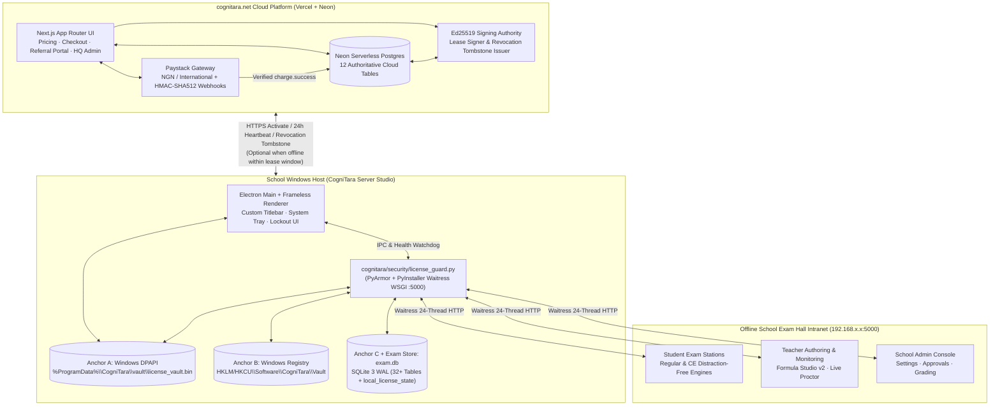
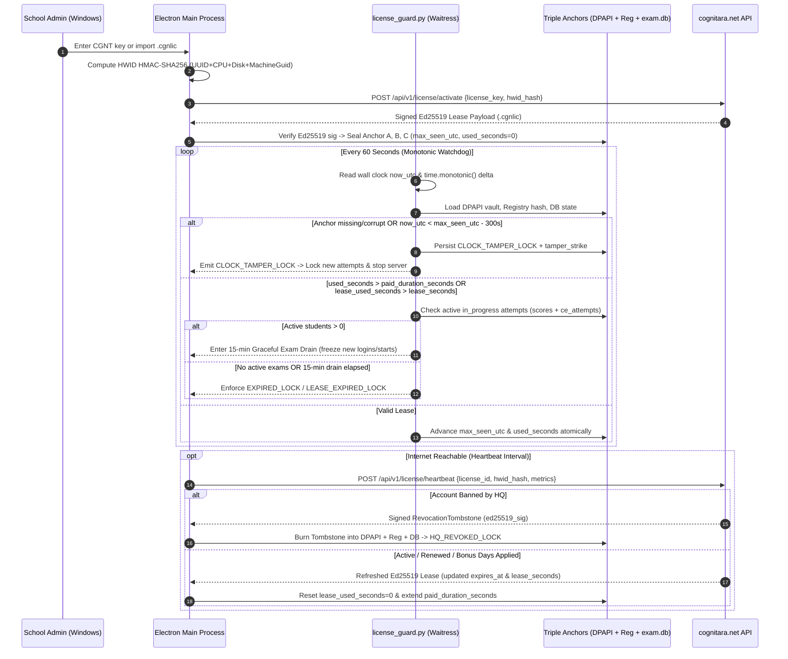
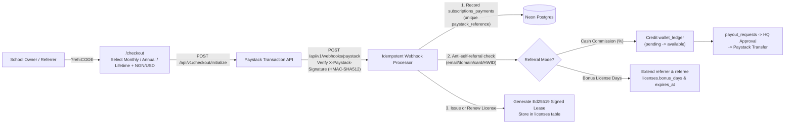

# CogniTara v2 — End-to-End Systems Architecture & Master Plan

**Document Status:** Stage 1 Architectural Baseline  
**Workspace Root:** `c:\COGNITARA EXAM PORTAL`  
**Target Deliverables:** Windows Super Admin Desktop App · Academic Portal v2 Overhaul · `cognitara.net` Cloud & Billing Platform · Stage 6 Launch Motion Advert  

---

## 1. Executive Summary & Verified Baseline Inventory

CogniTara v2 transforms the existing offline-first examination portal into a commercially licensable, desktop-native school examination suite paired with a cloud licensing, billing, and referral platform (`cognitara.net`), while upgrading every academic user journey without sacrificing offline reliability or data durability.

### 1.1 Verified Local Workspace & Toolchain Baseline
Every file path, schema count, and runtime version below was directly verified on disk in `c:\COGNITARA EXAM PORTAL`:

| Subsystem | Verified Asset / Version | Current Baseline State |
| :--- | :--- | :--- |
| **Application Entry** | `app.py` (42 lines), `wsgi.py` (Waitress), `cognitara/__init__.py` (`create_app`) | Modular Flask `3.1.0` + Waitress `3.0.2` (24 threads default, port `5000`) |
| **Route Surface** | `scripts/routes_baseline.json`, `scripts/inspect_routes.py`, `scripts/validate_architecture.py` | **201** pre-modularization baseline routes (100% parity); **221** active `url_map` rules across **13** blueprints (`home`, `auth`, `student`, `exam_regular`, `exam_ce`, `teacher`, `admin_dashboard`, `admin_users`, `admin_support`, `admin_exams`, `admin_results`, `admin_ce`, `admin_settings`) prior to Stage 1 `preview` blueprint |
| **Local Database** | `exam.db` (`cognitara/database/connection.py`, `cognitara/database/initialization.py`) | SQLite 3 (`PRAGMA journal_mode=WAL`, `synchronous=NORMAL`, `foreign_keys=ON`, `busy_timeout=30000`); **24** core tables in `docs/architecture/database.md` + **8** Phase 4.6 schema tables (`academic_sessions`, `ce_settings`, `classes`, `grading_scheme_rules`, `grading_schemes`, `school_settings`, `student_enrollment_history`, `student_promotions`) = **32 domain tables** (`33` `sqlite_master` entries incl. `sqlite_sequence`); `PRAGMA integrity_check` returns `ok` |
| **Templates & Static** | `templates/` (**73** HTML files), `static/js/` (`cognitara-actions.js`, `cognitara-calc.js`, `cognitara-katex-editor.js`), `static/vendor/` | Offline Bootstrap, FontAwesome, Chart.js, SweetAlert2, KaTeX + `contrib/mhchem.min.js` + `contrib/auto-render.min.js` |
| **Fonts & Brand Vectors** | `CogniTara-Brand-Identity/`, `static/fonts/`, `static/images/` | `CogniTaraType-{Bold,Regular}.{woff2,woff,ttf}`, `landing/InstrumentSans-{400,500,600}.woff2`, `cognitara-primary.svg`, `cognitara-primary-light.svg`, `cognitara-symbol.svg`, `cognitara-wordmark.svg`, `cognitara-app-icon.png`, `cognitara-favicon.ico`, `cognitara-identity.vectorcraft`, `cognitara_hero_video.mp4`, `static/images/screenshots/01_*.png`–`24_*.png` |
| **Automated Tests** | `tests/` (**40** tests collected via `pytest tests/`) | Includes `test_modular_architecture_and_persistence.py` (17 tests), `test_phase4_6_master.py`, `test_security_audit_phase4_4.py`, `test_disaster_recovery.py`, `test_browser_phase4_3.py`, `test_concurrent_load_50.py`, `test_pilot_concurrency_benchmark.py` |
| **Build & Security Toolchain** | Python `3.14.4`, Node `v24.19.0`, `cryptography 48.0.0`, `argon2-cffi 25.1.0`, `PyInstaller 6.20.0`, `pyarmor 9.2.4` | Installed locally (`pyarmor` currently reports `pyarmor-trial` license — see Risks in `tasks/plan.md` for large-module obfuscation mitigation) |
| **Motion & Media Toolchain** | `C:\Program Files\EffectCraft\effectcraft-cli.exe`, `ffmpeg 9.0.1`, `playwright`, `edge_tts`, `kokoro_onnx` | Root helper scripts exist (`prepare_motion_assets.py`, `build_cognitara_motion_suite.py`, `synthesize_cognitara_audio.py`, `render_all_deliverables.py`). Note: `CogniTara-Motion-Graphics/` and `cognitara-motion-studio/` do **not** exist on disk yet and will be initialized in Stage 6 from verified `CogniTara-Brand-Identity/` and `static/fonts/` assets |

### 1.2 Six-Stage Delivery Roadmap & Mandatory User Approval Gates

1. **Stage 1 (Current — Architecture & Live Desktop App Web Showcase):** Publish Master Plan, Task Breakdown, and interactive Super Admin Desktop App Web Showcase at `/desktop-preview` + `/api/preview/telemetry` -> **STOP FOR USER APPROVAL GATE #1**.
2. **Stage 2 (Windows Super Admin Desktop App Build):** Build packaged Windows desktop application (`desktop/` Electron custom frameless shell + Windows System Tray + PyInstaller/PyArmor Waitress daemon + 5-Layer Ed25519/DPAPI/Monotonic anti-tamper license vault).
3. **Stage 3 (Academic Portal UI/UX Overhaul):** Author Design Preview of redesigned Daylight Academic templates -> **STOP FOR USER APPROVAL GATE #2** -> Roll out redesigned Student Dashboard, Distraction-Free Exam Engine, Non-Occluding Dockable/Floating Scientific Calculator v2, Teacher Dashboard, Visual Math/Chemistry Formula Studio v2 (`KaTeX` + `mhchem`), School Admin & Common Entrance portals, preserving all 201 baseline routes and SQLite WAL invariants.
4. **Stage 4 (`cognitara.net` Cloud Platform):** Build Next.js App Router platform on Vercel + Neon Serverless Postgres + Paystack NGN/International Checkout & HMAC-SHA512 webhooks (`Monthly` / `Annual` / `Lifetime`) + Dual Referral Program (configurable cash commission wallet & payouts + bonus license days) + Ed25519 License Signing Authority + HQ Super Admin Portal.
5. **Stage 5 (Full-Stack Security & Regression Verification):** Execute adversarial security, anti-clock-tamper, DPAPI/registry anchor tampering, Paystack webhook replay, 15-minute graceful drain, and 201-route regression suites.
6. **Stage 6 (Launch Advert in Motion Graphics):** Scaffold `cognitara-motion-studio/projects/cognitara-v2-launch/`, produce 8-beat 9:16 vertical advert via EffectCraft CLI + FFmpeg using authentic CogniTara assets, neural voiceover, word-synchronized ASS captions, and EBU R128 mastering (`-14` to `-16 LUFS`, True-Peak `<= -1.0 dBTP`).

---

## 2. System Architecture Diagrams

### 2.1 Hybrid Cloud Licensing + Offline LAN Exam Topology



### 2.2 5-Layer Anti-Clock-Tamper & License Enforcement Lifecycle



### 2.3 Paystack Checkout, Dual Referral & Ed25519 Issuance Pipeline



---

## 3. CogniTara Signature Dual-Tone Design System

**Hard Aesthetic Rules:**
- **Zero Tailwind CSS** across Flask templates, Electron UI, and `cognitara.net` (authored using modular CSS custom properties + `@layer` architecture in `static/css/cognitara-tokens.css` and CSS Modules in Next.js).
- **Zero external CDNs** in offline portal/desktop views — all fonts, icons, KaTeX, and brand assets load from local `/static/` paths.
- **Zero rainbow clutter or generic AI SaaS tropes:** Strictly no unbranded violet/purple gradients, no decorative floating background icons, no tracked-out eyebrow spam above every heading, no em-dash fragment titles, and no `->` appended to buttons.

### 3.1 Color Token Matrix

#### Tier A — Dark Command (`[data-ct-surface="dark-command"]` — Desktop App, `/desktop-preview`, `cognitara.net`)

| Token Name | Hex / Value | Usage |
| :--- | :--- | :--- |
| `--ct-void` | `#060913` | Outer desktop backdrop, recessed viewport canvas |
| `--ct-navy` | `#0A0E1A` | Primary window shell background, navigation rail |
| `--ct-surface-1` | `#0F1628` | Primary cards, telemetry panels, command console |
| `--ct-surface-2` | `#162038` | Elevated drawers, active nav states, hover panels |
| `--ct-border` | `rgba(148, 163, 184, 0.14)` | Hairline structural borders |
| `--ct-border-strong` | `rgba(0, 210, 255, 0.28)` | Active focus rings, selected license tier border |
| `--ct-cyan` | `#00D2FF` | Tara Star beacon, active LAN status ring, primary highlights |
| `--ct-cobalt` | `#0066FF` | Primary CTA buttons, active focus states |
| `--ct-white` | `#FFFFFF` | Primary headings, Luminary C crescent body |
| `--ct-slate` | `#94A3B8` | Secondary labels, metadata, timestamps |
| `--ct-slate-dim` | `#64748B` | Disabled/tertiary hints |
| `--ct-ok` / `--ct-warn` / `--ct-danger` | `#10B981` / `#F59E0B` / `#EF4444` | Semantic badges & hardware/lockout indicators ONLY |

#### Tier B — Daylight Academic (`[data-ct-surface="daylight-portal"]` — Student, Exam Engine, Calculator v2, Teacher, School Admin, Common Entrance)

| Token Name | Hex / Value | Usage |
| :--- | :--- | :--- |
| `--ct-paper` | `#F8FAFC` | Examination & dashboard reading canvas |
| `--ct-card` | `#FFFFFF` | Question cards, answer panels, KPI containers |
| `--ct-ink` | `#0A0E1A` | Primary body & question typography (WCAG AAA contrast) |
| `--ct-cobalt` | `#0066FF` | Primary actions, active question pill, progress fill |
| `--ct-cyan` | `#00D2FF` | Subtle focus accents, docked tool indicator |
| `--ct-muted` | `#64748B` | Secondary instructions, question metadata |
| `--ct-line` | `#E2E8F0` | Card borders, table dividers, option separators |
| `--ct-ok` / `--ct-warn` / `--ct-danger` | `#059669` / `#D97706` / `#DC2626` | Semantic validation, warning counters, submission alerts ONLY |

### 3.2 Typography, Spacing, Radii & Motion Tokens

| Category | Verified Asset / Value | Rule |
| :--- | :--- | :--- |
| **Brand Display Font** | `CogniTaraType` (`700` -> `/static/fonts/CogniTaraType-Bold.woff2`, `.woff`, `.ttf`; `400` -> `/static/fonts/CogniTaraType-Regular.woff2`, `.woff`, `.ttf`) | Wordmark lockups, boot titles, primary modal headings |
| **UI & Academic Body Font** | `Instrument Sans` (`400`, `500`, `600` -> `/static/fonts/landing/InstrumentSans-{400,500,600}.woff2`) | Dashboards, exam questions, tables, forms |
| **Monospace Font** | `'JetBrains Mono', ui-monospace, SFMono-Regular, Consolas, monospace` | Countdown timers, HWID hashes, license keys, LAN IPs, console logs |
| **Spacing & Radii** | `4px` base grid (`--ct-space-1`..`16`) · Radii `6px` (`--ct-radius-sm`), `10px` (`--ct-radius-md`), `14px` (`--ct-radius-lg`) | Disciplined geometry; no oversized `24px–32px` pillow cards everywhere |
| **Motion Curves** | `--ct-ease-out: cubic-bezier(0.16, 1, 0.3, 1)` · `--ct-ease-spring: cubic-bezier(0.22, 1, 0.36, 1)` | Respect `@media (prefers-reduced-motion: reduce)` across all views |

### 3.3 Authentic Brand Mark Geometry (`CogniTara-Brand-Identity/cognitara-symbol.svg`)
All SVG icons, Electron boot screens, `/desktop-preview`, and video assets MUST use the exact canonical vector geometry (`viewBox="0 0 200 200"`):
- **Luminary C Crescent (`#FFFFFF` on dark / `#0A0E1A` on light):** `M 150.91,150.91 C 122.79,179.03 77.21,179.03 49.09,150.91 C 20.97,122.79 20.97,77.21 49.09,49.09 C 77.21,20.97 122.79,20.97 150.91,49.09 L 131.11,68.89 C 113.93,51.70 86.07,51.70 68.89,68.89 C 51.70,86.07 51.70,113.93 68.89,131.11 C 86.07,148.30 113.93,148.30 131.11,131.11 Z`
- **Tara Guiding Star (`#00D2FF`):** `M 108.00,74.00 C 115.00,93.00 115.00,93.00 146.00,100.00 C 115.00,107.00 115.00,107.00 108.00,126.00 C 101.00,107.00 101.00,107.00 90.00,100.00 C 101.00,93.00 101.00,93.00 108.00,74.00 Z`
- Generic polygons, custom drawn hexagons, or standard star glyphs are strictly banned.

---

## 4. Stage 1 & Stage 2 — Super Admin Desktop App & 5-Layer License Vault

### 4.1 Stage 1 Web Showcase (`/desktop-preview` & `/api/preview/telemetry`)
- **Blueprint:** `cognitara/routes/preview.py` (`preview_bp`) registered in `cognitara/routes/__init__.py` `ALL_BLUEPRINTS`.
- **Strictly Read-Only Telemetry:** `PRAGMA query_only = ON` queries against `school_settings`, `exams`, `ce_exams`, `students`, `teachers`, `scores`, `ce_attempts`, `PRAGMA journal_mode`, and `PRAGMA quick_check`, combined with local hostname and non-loopback LAN IPv4 discovery (`hostname`, `lan_ips`, `primary_lan_ip`, `is_lan_online`, `primary_lan_url`, `hostname_url`, `loopback_url`, `counts`, `db_journal_mode`, `db_health`, `port`, `server_time_wat`, `waitress_threads`) without mutating `exam.db`.
- **Interactive Showcase (`templates/preview/desktop_app_preview.html`):** Frameless Windows 11 desktop shell (1240×780 + Full Viewport toggle + System Tray minimize popover) featuring all 5 states:
  1. **State 1:** Cinematic Luminary C Boot & Cryptographic/DB/Waitress Initialization.
  2. **State 2:** 4-Step Animated Super Admin Onboarding (Institution Profile, Hardware-Locked License Activation with HWID copy & `.cgnlic` dropzone, LAN/Integrity Calibration, Seal Complete).
  3. **State 3:** Super Admin Command Center (View A: Engine Control with orbital Server Core + deterministic inline SVG QR + LAN URLs; View B: Live Hall Monitor; View C: License & Security Vault with Monthly/Annual/Lifetime switcher & 3-anchor integrity; View D: SQLite WAL Backups & Integrity; View E: Structured Waitress/Security Console).
  4. **State 4:** License Expired & `CLOCK_TAMPER_LOCK` Screen (sub-toggle + 15-min active-exam drain notice).
  5. **State 5:** HQ Account Banned / Signed Revocation Tombstone Lockout Screen.

### 4.2 Stage 2 Packaged Windows Desktop Architecture (`desktop/`)
- **Process Model:**
  - **Electron Main Process (`desktop/src/main/index.ts`):** Frameless `BrowserWindow` (`frame: false`, `contextIsolation: true`, `nodeIntegration: false`, `sandbox: true`), Windows System Tray (`Tray` with Start/Stop Server, Open Student/Admin Portal in Default Browser, License Vault, Quit with graceful active-exam check), Single-Instance Lock (`app.requestSingleInstanceLock()`).
  - **Electron Preload (`desktop/src/preload/index.ts`):** Exposes strict typed IPC bridge (`window.cognitaraDesktop`) for window controls, server lifecycle (`startServer`, `stopServer`), hardware ID query, `.cgnlic` file picker, and instant hot backup (`sqlite3.backup()`).
  - **Packaged Python Daemon:** `wsgi.py` + `cognitara/` frozen via `PyInstaller 6.20.0` (`--onedir` into `resources/engine/cognitara-engine.exe`), with `cognitara/security/license_guard.py` and `cognitara/__init__.py` protected by `PyArmor 9.2.4` before bundling.

### 4.3 5-Layer Windows License & Anti-Clock-Tamper Specification

#### Layer 1 — Ed25519 Signed Lease Payload (`.cgnlic` & Heartbeat JSON)
Canonical UTF-8 JSON serialized with sorted keys and no whitespace (`separators=(",", ":")`) over the `payload` object, signed with the `cognitara.net` Ed25519 private key (`cryptography.hazmat.primitives.asymmetric.ed25519`). Public key `ED25519_PUBLIC_KEY_B64` is compiled inside both Electron main and PyArmor-protected `license_guard.py`.

```json
{
  "schema_version": 2,
  "key_id": "ct-ed25519-2026-01",
  "payload": {
    "license_id": "lic_01JXYZ9A8B7C6D5E4F3G",
    "license_key": "CGNT-84K2-91MP-Q7RX-V3N8",
    "school_id": "sch_01JXYW22334455667788",
    "school_name": "CogniTara High School",
    "plan_tier": "annual",
    "issued_at": "2026-11-18T00:00:00Z",
    "expires_at": "2027-11-18T00:00:00Z",
    "paid_duration_seconds": 31536000,
    "bonus_days_applied": 14,
    "lease_seconds": 2592000,
    "hwid_hash": "8f4b7e2c91a04d3e6f7a8b9c0d1e2f3a4b5c6d7e8f9a0b1c2d3e4f5a6b7c8d9e",
    "features": {
      "max_concurrent_stations": 300,
      "ce_portal": true,
      "formula_studio_v2": true,
      "hot_backup": true
    }
  },
  "ed25519_sig": "base64url_64_byte_ed25519_signature"
}
```
- **Plan Tier Semantics:**
  - `monthly`: `paid_duration_seconds = 30 * 86400 + bonus_days * 86400`, `lease_seconds = 7 * 86400` (offline grace refresh interval).
  - `annual`: `paid_duration_seconds = 365 * 86400 + bonus_days * 86400`, `lease_seconds = 30 * 86400`.
  - `lifetime`: `expires_at = null`, `paid_duration_seconds = null`, `lease_seconds = 90 * 86400` (anti-piracy periodic heartbeat refresh; monotonic counter still prevents lease rollover beyond `90d` offline without sync unless `offline_grace_override` is issued by HQ).

#### Layer 2 — Hardware Fingerprint Binding (`hwid_hash`)
Collected on Windows via WMI / CIM / Win32 Registry without shelling out to brittle text parsers when native APIs exist:
1. `Win32_ComputerSystemProduct.UUID` (BIOS/SMBIOS UUID)
2. `Win32_Processor.ProcessorId`
3. Primary physical boot disk serial (`Win32_DiskDrive WHERE Index=0` -> `SerialNumber`, trimmed)
4. `HKLM\SOFTWARE\Microsoft\Cryptography\MachineGuid`

Canonical construction:
```python
raw = "|".join([smbios_uuid.upper(), cpu_id.upper(), disk_serial.upper(), machine_guid.lower()])
hwid_hash = hmac.new(APP_HWID_PEPPER, raw.encode("utf-8"), hashlib.sha256).hexdigest()
display_hwid = f"CT-HWID-{hwid_hash[:4].upper()}-{hwid_hash[4:8].upper()}-{hwid_hash[8:12].upper()}"
```
Component hashes are also stored individually inside `license_activations.hw_components_json` on `cognitara.net`; if >= 3 of 4 match (e.g., SSD replacement), HQ/self-service allowance permits smooth re-binding without instant lockout, whereas <= 2 of 4 triggers `HWID_MISMATCH_LOCK` requiring HQ HWID Reset.

#### Layer 3 — Triple-Anchor High-Water-Mark UTC & Monotonic Elapsed Counter
Every 60 seconds, `license_guard.py` computes `delta = max(0, time.monotonic() - last_monotonic_tick)`, advances `used_seconds += delta`, `lease_used_seconds += delta`, and `max_seen_utc = max(max_seen_utc, now_utc)`, then atomically writes all three anchors:

1. **Anchor A — Windows DPAPI Vault (`%ProgramData%\CogniTara\vault\license_vault.bin`):**
   Encrypted via Windows `crypt32.dll!CryptProtectData` (`CRYPTPROTECT_LOCAL_MACHINE` + deterministic application entropy bytes `b"CogniTara-Vault-v2"`). Plaintext JSON inside DPAPI envelope:
   ```json
   {
     "vault_version": 2,
     "license_id": "lic_01JXYZ...",
     "hwid_hash": "8f4b7e2c...",
     "signed_lease": { "...": "full Ed25519 lease object" },
     "activated_at_utc": 1795000000,
     "last_heartbeat_utc": 1795000000,
     "max_seen_utc": 1795086400,
     "used_seconds": 86400,
     "lease_used_seconds": 86400,
     "tamper_strikes": 0,
     "lock_state": "ACTIVE",
     "revocation_tombstone": null,
     "state_hmac": "sha256_hmac_with_hwid_derived_key"
   }
   ```
2. **Anchor B — Windows Registry Anchor (`HKLM\SOFTWARE\CogniTara\Vault` with automatic fallback to `HKCU\Software\CogniTara\Vault` if running non-elevated):**
   Stores `LicenseId`, `MaxSeenUtc` (QWORD), `UsedSeconds` (QWORD), `LockState` (REG_SZ), and `AnchorMac` (HMAC-SHA256 over the preceding values + `hwid_hash` so manual RegEdit tampering immediately invalidates the MAC).
3. **Anchor C — SQLite `exam.db` Anchor (`local_license_state` table + exam timestamp cross-check):**
   Additive table created non-destructively via `cognitara/database/initialization.py`:
   ```sql
   CREATE TABLE IF NOT EXISTS local_license_state (
       id INTEGER PRIMARY KEY CHECK (id = 1),
       license_id TEXT NOT NULL,
       max_seen_utc INTEGER NOT NULL,
       used_seconds INTEGER NOT NULL DEFAULT 0,
       lock_state TEXT NOT NULL DEFAULT 'ACTIVE',
       active_exam_drain_until INTEGER DEFAULT NULL,
       vault_checksum TEXT NOT NULL,
       updated_at DATETIME DEFAULT CURRENT_TIMESTAMP
   );
   ```
   Also inspects `MAX(strftime('%s', updated_at))` across `scores` and `ce_attempts` on boot: if the Windows clock is rolled back before recorded student exam activity, `CLOCK_TAMPER_LOCK` triggers even if someone restored an older VM snapshot of `vault.bin`!

**Tamper & Expiry Decision Matrix:**
- `now_utc < max_seen_utc - 300`: Trips `CLOCK_TAMPER_LOCK` immediately (>300s clock rollback).
- Missing `vault.bin` while Registry OR `local_license_state` already exists for `license_id`: Trips `CLOCK_TAMPER_LOCK` (blocks delete-and-reinstall rollback).
- `paid_duration_seconds is not None and used_seconds >= paid_duration_seconds` OR `now_utc > expires_at_ts`:
  - Check `SELECT COUNT(*) FROM scores WHERE status='in_progress'` + `SELECT COUNT(*) FROM ce_attempts WHERE status='in_progress'`.
  - If count > 0 and `active_exam_drain_until` is unset: set `active_exam_drain_until = now_utc + 900` (15-minute graceful drain), block new exam starts/logins, allow active exams to finish and auto-submit, then transition to `EXPIRED_LOCK`.
  - If count == 0 or drain window expired: enforce `EXPIRED_LOCK`.

#### Layer 4 — Remote HQ Ban & Signed Revocation Tombstone
Returned on `POST /api/v1/license/heartbeat` (or pushed when checking `/api/v1/license/status`):
```json
{
  "status": "REVOKED",
  "tombstone": {
    "schema_version": 2,
    "tombstone_id": "tmb_01JXZ99887766",
    "school_id": "sch_01JXYW...",
    "license_id": "lic_01JXYZ...",
    "reason_code": "TOS_VIOLATION_NONPAYMENT",
    "reason_detail": "License permanently revoked by CogniTara HQ Compliance.",
    "revoked_at": "2026-11-20T14:22:10Z",
    "effective_immediately": true
  },
  "ed25519_sig": "base64url_64_byte_ed25519_signature"
}
```
Once signature-verified, the tombstone is burned into all 3 anchors; local engine switches immediately to `HQ_REVOKED_LOCK` (State 5) even if internet is subsequently disconnected.

#### Layer 5 — Dual-Process Enforcement
1. **Electron Main Process:** Calls `verifyVaultOnStartup()` before starting `cognitara-engine.exe`; disables server start IPC and surfaces State 4 or State 5 UI whenever `lock_state != "ACTIVE"`.
2. **Python WSGI Daemon (`cognitara/security/license_guard.py`, compiled & obfuscated via PyArmor):** Invoked inside `wsgi.py` startup, inside `create_app()` (`cognitara/__init__.py`), via a 60-second background watchdog thread, and via `@app.before_request` hook (exempting `/health`, `/static/*`, and `/api/internal/license-status` read-only reporting, while failing closed with HTTP `403` / lock page on active portal routes when `lock_state in {'CLOCK_TAMPER_LOCK', 'EXPIRED_LOCK', 'HQ_REVOKED_LOCK', 'HWID_MISMATCH_LOCK'}`). Test isolation mode (`COGNITARA_TESTING_BYPASS_LICENSE=1` only accepted when `app.config['TESTING'] == True` and stripped in frozen builds via `getattr(sys, 'frozen', False)`) preserves fast pytest execution while preventing env-var bypass in production!

---

## 5. Stage 3 — Academic Portal UI/UX Overhaul Blueprint (Approval Gate #2)

All Stage 3 updates apply **Tier B (Daylight Academic)** tokens from `static/css/cognitara-tokens.css` + a new shared stylesheet `static/css/cognitara-academic.css`, preserving 100% of existing route URLs, CSRF meta/headers, form field names, and `cognitara-actions.js` hooks across all 73 templates.

### 5.1 Redesign Scope Across 6 Portals

| Portal / Module | Existing Template(s) / Assets | Stage 3 Target Upgrades |
| :--- | :--- | :--- |
| **Student & CE Dashboards** | `templates/dashboard.html`, `templates/ce_dashboard.html` | Replace purple/violet gradient stat icons with crisp `#FFFFFF` 1px `#E2E8F0` bordered KPI cards, Cobalt `#0066FF` primary CTA, semantic status chips (`#059669` / `#D97706` / `#DC2626`), clear active-exam resume cards, and `Instrument Sans` typography. |
| **Distraction-Free Exam Engine** | `templates/exam_page.html`, `templates/ce_exam_page.html`, `templates/exam_start.html`, `templates/exam_paused.html` | CSS Grid responsive workspace (`1fr` reading lane `max-width: 780px` + collapsible question palette rail), 64px top bar (candidate badge, server countdown pill, connection status dot, Calc toggle, Submit CTA), zero decorative distractions, strict parity with `exam_save_single_answer`, `exam_heartbeat`, `log_warning`, and `session_key` lease fencing. |
| **Scientific Calculator v2** | Upgrades `static/js/cognitara-calc.js` -> `static/js/cognitara-calc-v2.js` | **Non-occluding Docked Split-Pane mode** (opens smoothly in right CSS grid column `340px` without covering question text or radio buttons!) + **Floating Edge-Snapping mode** (viewport-clamped drag, compact toggle), full DEG/RAD toggle, 8-entry calculation history tape, 100% offline AST/`/api/calculate` (`SafeMathEvaluator`) compatibility. |
| **Teacher Dashboard & Authoring** | `templates/teacher_dashboard.html`, `templates/teacher_create_exam.html`, `templates/teacher_edit_exam.html`, `templates/exam_questions.html`, `templates/ce_questions.html` | Unified left/top Academic Cobalt workspace, Form Tutor class insights panel, clean live-exam proctor actions, removal of floating `.edu-icon` background animations and mixed purple/pink gradients. |
| **Formula Studio v2 (`KaTeX` + `mhchem`)** | Upgrades `static/js/cognitara-katex-editor.js` -> `static/js/cognitara-formula-studio-v2.js` | Offline KaTeX + `mhchem` WYSIWYG interactive pills inside question/option boxes, categorized template drawers (Fractions & Roots, Exponents & Greek, Calculus & Matrices, Balanced Chemistry Equations `\ce{...}`), keyboard shortcuts (`Ctrl+M` / `Ctrl+Shift+C`), zero raw LaTeX leaks. |
| **School Admin & Common Entrance** | `templates/admin.html`, `templates/admin_school_settings.html`, `templates/admin_common_entrance.html`, `templates/admin_exam_technical_support.html`, `templates/admin_exams_management.html`, `templates/ce_*.html` | Cohesive Daylight Academic Cobalt/Slate hierarchy replacing legacy multi-color card gradients while retaining every AJAX/SweetAlert2/CSV/Excel/audit-log contract. |

**Mandatory Approval Gate #2:** Stage 3 first creates a lightweight **Design Preview showcase** (e.g., representative preview captures / preview templates covering Exam Engine + Calculator v2 + Formula Studio v2 + Student/Admin Dashboards) and stops for explicit user approval before rolling across all remaining templates.

---

## 6. Stage 4 — `cognitara.net` Cloud Platform & Neon Postgres DDL

### 6.1 Cloud Stack & Core Modules (`cloud/` or `cognitara-cloud/`)
- **Framework:** Next.js 15+ (App Router, React 19, TypeScript) deployed on Vercel (`cognitara.net`), styled strictly with CogniTara **Tier A Dark Command** CSS custom properties + CSS Modules (zero Tailwind v3).
- **Database:** **Neon Serverless Postgres** (`@neondatabase/serverless`) with connection pooling and parameterized SQL / Drizzle schema.
- **Payments:** **Paystack** (`POST https://api.paystack.co/transaction/initialize`, `GET /transaction/verify/:reference`, and webhook receiver `POST /api/v1/webhooks/paystack` verifying `x-paystack-signature` via `crypto.timingSafeEqual` over `HMAC-SHA512(PAYSTACK_SECRET_KEY, rawBody)`). Supports NGN & USD/International cards/transfers for `Monthly`, `Annual`, and `Lifetime` plans.
- **Ed25519 Signing Authority:** Dedicated server-only signer (`lib/crypto/ed25519.ts`) loading `COGNITARA_ED25519_PRIVATE_KEY_PEM` from Vercel encrypted environment secrets to sign `.cgnlic` leases and `RevocationTombstone` payloads.
- **Dual Referral Program:**
  - Every verified account or affiliate gets a unique referral link (`https://cognitara.net/?ref=CODE`).
  - Admin-configurable reward rules per plan/campaign:
    1. **Cash Commission Wallet:** Credits `commission_pct` (default e.g. `15%`, configurable per referrer) of net Paystack payment to `wallet_ledger` (`status: pending` -> `available`), with bank payout requests (`payout_requests`) settled via HQ approval / Paystack Transfers.
    2. **Bonus License Days:** Credits `bonus_days_referrer` and/or `bonus_days_referee` (default e.g. `14` days on Monthly / `30` days on Annual, configurable), automatically extending `licenses.expires_at` + `paid_duration_seconds` and issuing a refreshed Ed25519 lease on next Desktop App heartbeat.
  - Anti-abuse checks: blocks self-referrals matching same `owner_user_id`, normalized email, Paystack `authorization.signature`, or bound `hwid_hash`.

### 6.2 Neon Serverless Postgres Authoritative SQL DDL (All 12 Tables)

```sql
-- Extensions
CREATE EXTENSION IF NOT EXISTS pgcrypto;

-- 1. HQ Users (School Owners, Affiliates, HQ Super Admins)
CREATE TABLE users_hq (
    id UUID PRIMARY KEY DEFAULT gen_random_uuid(),
    email TEXT NOT NULL UNIQUE,
    password_hash TEXT NOT NULL, -- Argon2id
    full_name TEXT NOT NULL,
    phone TEXT,
    role TEXT NOT NULL DEFAULT 'school_owner' CHECK (role IN ('school_owner', 'affiliate', 'hq_admin', 'hq_super_admin')),
    email_verified_at TIMESTAMPTZ,
    mfa_enabled BOOLEAN NOT NULL DEFAULT FALSE,
    status TEXT NOT NULL DEFAULT 'active' CHECK (status IN ('active', 'suspended', 'banned')),
    created_at TIMESTAMPTZ NOT NULL DEFAULT NOW(),
    updated_at TIMESTAMPTZ NOT NULL DEFAULT NOW()
);

-- 2. Registered Customer Schools
CREATE TABLE schools (
    id UUID PRIMARY KEY DEFAULT gen_random_uuid(),
    owner_user_id UUID NOT NULL REFERENCES users_hq(id) ON DELETE RESTRICT,
    school_name TEXT NOT NULL,
    country_code CHAR(2) NOT NULL DEFAULT 'NG',
    state_region TEXT,
    contact_email TEXT NOT NULL,
    contact_phone TEXT,
    referral_code_used TEXT,
    status TEXT NOT NULL DEFAULT 'active' CHECK (status IN ('active', 'suspended', 'banned')),
    ban_reason TEXT,
    banned_at TIMESTAMPTZ,
    created_at TIMESTAMPTZ NOT NULL DEFAULT NOW(),
    updated_at TIMESTAMPTZ NOT NULL DEFAULT NOW()
);
CREATE INDEX idx_schools_owner ON schools(owner_user_id);
CREATE INDEX idx_schools_status ON schools(status);

-- 3. Commercial Plans & Configurable Referral Policies
CREATE TABLE plans (
    id UUID PRIMARY KEY DEFAULT gen_random_uuid(),
    slug TEXT NOT NULL UNIQUE CHECK (slug IN ('monthly', 'annual', 'lifetime')),
    display_name TEXT NOT NULL,
    billing_cycle TEXT NOT NULL CHECK (billing_cycle IN ('monthly', 'annual', 'lifetime')),
    duration_days INTEGER, -- NULL for lifetime perpetual
    lease_days INTEGER NOT NULL DEFAULT 30,
    price_ngn_kobo BIGINT NOT NULL CHECK (price_ngn_kobo > 0),
    price_usd_cents BIGINT NOT NULL CHECK (price_usd_cents > 0),
    default_commission_pct NUMERIC(5,2) NOT NULL DEFAULT 15.00 CHECK (default_commission_pct >= 0 AND default_commission_pct <= 60),
    default_bonus_days INTEGER NOT NULL DEFAULT 14 CHECK (default_bonus_days >= 0),
    features_json JSONB NOT NULL DEFAULT '{}'::jsonb,
    is_active BOOLEAN NOT NULL DEFAULT TRUE,
    created_at TIMESTAMPTZ NOT NULL DEFAULT NOW(),
    updated_at TIMESTAMPTZ NOT NULL DEFAULT NOW()
);

-- 4. Paystack Subscriptions & One-Time Payments
CREATE TABLE subscriptions_payments (
    id UUID PRIMARY KEY DEFAULT gen_random_uuid(),
    school_id UUID NOT NULL REFERENCES schools(id) ON DELETE CASCADE,
    user_id UUID NOT NULL REFERENCES users_hq(id) ON DELETE RESTRICT,
    plan_id UUID NOT NULL REFERENCES plans(id) ON DELETE RESTRICT,
    paystack_reference TEXT NOT NULL UNIQUE,
    paystack_transaction_id BIGINT UNIQUE,
    paystack_customer_code TEXT,
    paystack_authorization_sig TEXT,
    currency CHAR(3) NOT NULL CHECK (currency IN ('NGN', 'USD')),
    amount_minor BIGINT NOT NULL CHECK (amount_minor > 0),
    status TEXT NOT NULL DEFAULT 'initialized' CHECK (status IN ('initialized', 'success', 'failed', 'refunded', 'disputed')),
    webhook_event_id TEXT UNIQUE,
    raw_webhook_payload JSONB,
    paid_at TIMESTAMPTZ,
    created_at TIMESTAMPTZ NOT NULL DEFAULT NOW()
);
CREATE INDEX idx_sub_pay_school ON subscriptions_payments(school_id, created_at DESC);

-- 5. Ed25519 Licenses
CREATE TABLE licenses (
    id UUID PRIMARY KEY DEFAULT gen_random_uuid(),
    license_key TEXT NOT NULL UNIQUE, -- CGNT-XXXX-XXXX-XXXX-XXXX
    school_id UUID NOT NULL REFERENCES schools(id) ON DELETE CASCADE,
    plan_id UUID NOT NULL REFERENCES plans(id) ON DELETE RESTRICT,
    latest_payment_id UUID REFERENCES subscriptions_payments(id) ON DELETE SET NULL,
    plan_tier TEXT NOT NULL CHECK (plan_tier IN ('monthly', 'annual', 'lifetime')),
    status TEXT NOT NULL DEFAULT 'issued' CHECK (status IN ('issued', 'active', 'expired', 'revoked', 'suspended')),
    issued_at TIMESTAMPTZ NOT NULL DEFAULT NOW(),
    expires_at TIMESTAMPTZ, -- NULL for lifetime
    bonus_days_total INTEGER NOT NULL DEFAULT 0,
    lease_seconds INTEGER NOT NULL DEFAULT 2592000,
    max_activations INTEGER NOT NULL DEFAULT 1,
    signed_lease_json JSONB NOT NULL,
    ed25519_sig TEXT NOT NULL,
    revocation_tombstone_json JSONB,
    created_at TIMESTAMPTZ NOT NULL DEFAULT NOW(),
    updated_at TIMESTAMPTZ NOT NULL DEFAULT NOW()
);
CREATE INDEX idx_licenses_school ON licenses(school_id, status);

-- 6. Hardware Activations (1-to-1 HWID Binding + HQ HWID Reset Audit)
CREATE TABLE license_activations (
    id UUID PRIMARY KEY DEFAULT gen_random_uuid(),
    license_id UUID NOT NULL REFERENCES licenses(id) ON DELETE CASCADE,
    hwid_hash CHAR(64) NOT NULL,
    display_hwid TEXT NOT NULL,
    machine_hostname TEXT,
    os_version TEXT,
    hw_components_json JSONB NOT NULL DEFAULT '{}'::jsonb,
    is_active BOOLEAN NOT NULL DEFAULT TRUE,
    activated_at TIMESTAMPTZ NOT NULL DEFAULT NOW(),
    deactivated_at TIMESTAMPTZ,
    deactivated_by UUID REFERENCES users_hq(id),
    deactivation_reason TEXT
);
CREATE UNIQUE INDEX uq_active_license_hwid ON license_activations(license_id) WHERE is_active = TRUE;
CREATE INDEX idx_activations_hwid ON license_activations(hwid_hash);

-- 7. Desktop Telemetry & Anti-Tamper Heartbeats
CREATE TABLE license_heartbeats (
    id BIGSERIAL PRIMARY KEY,
    license_id UUID NOT NULL REFERENCES licenses(id) ON DELETE CASCADE,
    activation_id UUID REFERENCES license_activations(id) ON DELETE SET NULL,
    hwid_hash CHAR(64) NOT NULL,
    app_version TEXT NOT NULL,
    client_utc TIMESTAMPTZ NOT NULL,
    server_utc TIMESTAMPTZ NOT NULL DEFAULT NOW(),
    used_seconds BIGINT NOT NULL DEFAULT 0,
    lock_state TEXT NOT NULL,
    tamper_strikes INTEGER NOT NULL DEFAULT 0,
    active_exams_count INTEGER NOT NULL DEFAULT 0,
    approved_students_count INTEGER NOT NULL DEFAULT 0,
    client_ip INET
);
CREATE INDEX idx_heartbeats_license_time ON license_heartbeats(license_id, server_utc DESC);

-- 8. Referral Codes & Dual-Mode Partner Configuration
CREATE TABLE referrals (
    id UUID PRIMARY KEY DEFAULT gen_random_uuid(),
    owner_user_id UUID NOT NULL REFERENCES users_hq(id) ON DELETE CASCADE,
    school_id UUID REFERENCES schools(id) ON DELETE SET NULL,
    referral_code TEXT NOT NULL UNIQUE,
    reward_mode TEXT NOT NULL DEFAULT 'dual' CHECK (reward_mode IN ('cash_commission', 'bonus_days', 'dual')),
    custom_commission_pct NUMERIC(5,2) CHECK (custom_commission_pct >= 0 AND custom_commission_pct <= 60),
    custom_bonus_days INTEGER CHECK (custom_bonus_days >= 0),
    is_active BOOLEAN NOT NULL DEFAULT TRUE,
    created_at TIMESTAMPTZ NOT NULL DEFAULT NOW()
);

-- 9. Referral Conversions (Idempotent per Payment)
CREATE TABLE referral_conversions (
    id UUID PRIMARY KEY DEFAULT gen_random_uuid(),
    referral_id UUID NOT NULL REFERENCES referrals(id) ON DELETE RESTRICT,
    referrer_user_id UUID NOT NULL REFERENCES users_hq(id) ON DELETE RESTRICT,
    referred_school_id UUID NOT NULL REFERENCES schools(id) ON DELETE CASCADE,
    payment_id UUID NOT NULL UNIQUE REFERENCES subscriptions_payments(id) ON DELETE CASCADE,
    applied_reward_mode TEXT NOT NULL CHECK (applied_reward_mode IN ('cash_commission', 'bonus_days', 'dual')),
    commission_pct_applied NUMERIC(5,2) NOT NULL DEFAULT 0,
    commission_amount_kobo BIGINT NOT NULL DEFAULT 0,
    bonus_days_granted_referrer INTEGER NOT NULL DEFAULT 0,
    bonus_days_granted_referee INTEGER NOT NULL DEFAULT 0,
    status TEXT NOT NULL DEFAULT 'credited' CHECK (status IN ('pending', 'credited', 'reversed_fraud')),
    created_at TIMESTAMPTZ NOT NULL DEFAULT NOW()
);
CREATE INDEX idx_ref_conv_referrer ON referral_conversions(referrer_user_id, created_at DESC);

-- 10. Immutable Cash Commission Wallet Ledger
CREATE TABLE wallet_ledger (
    id UUID PRIMARY KEY DEFAULT gen_random_uuid(),
    user_id UUID NOT NULL REFERENCES users_hq(id) ON DELETE RESTRICT,
    conversion_id UUID REFERENCES referral_conversions(id) ON DELETE SET NULL,
    payout_request_id UUID, -- linked after payout_requests creation
    entry_type TEXT NOT NULL CHECK (entry_type IN ('commission_credit', 'payout_hold', 'payout_release', 'payout_settled', 'reversal')),
    currency CHAR(3) NOT NULL DEFAULT 'NGN',
    amount_minor BIGINT NOT NULL, -- signed integer (+ credit, - debit)
    balance_after_minor BIGINT NOT NULL CHECK (balance_after_minor >= 0),
    idempotency_key TEXT NOT NULL UNIQUE,
    notes TEXT,
    created_at TIMESTAMPTZ NOT NULL DEFAULT NOW()
);
CREATE INDEX idx_wallet_user_time ON wallet_ledger(user_id, created_at DESC);

-- 11. Affiliate / School Owner Payout Requests
CREATE TABLE payout_requests (
    id UUID PRIMARY KEY DEFAULT gen_random_uuid(),
    user_id UUID NOT NULL REFERENCES users_hq(id) ON DELETE RESTRICT,
    currency CHAR(3) NOT NULL DEFAULT 'NGN',
    amount_minor BIGINT NOT NULL CHECK (amount_minor > 0),
    bank_code TEXT NOT NULL,
    account_number_masked TEXT NOT NULL,
    paystack_recipient_code TEXT,
    paystack_transfer_code TEXT UNIQUE,
    status TEXT NOT NULL DEFAULT 'pending' CHECK (status IN ('pending', 'approved', 'processing', 'paid', 'rejected')),
    reviewed_by UUID REFERENCES users_hq(id),
    reviewed_at TIMESTAMPTZ,
    rejection_reason TEXT,
    created_at TIMESTAMPTZ NOT NULL DEFAULT NOW()
);
CREATE INDEX idx_payout_status ON payout_requests(status, created_at ASC);

-- 12. HQ Compliance Bans, Revocations & HWID Reset Audit Trail
CREATE TABLE school_bans_audit (
    id UUID PRIMARY KEY DEFAULT gen_random_uuid(),
    school_id UUID NOT NULL REFERENCES schools(id) ON DELETE CASCADE,
    license_id UUID REFERENCES licenses(id) ON DELETE SET NULL,
    actor_hq_user_id UUID NOT NULL REFERENCES users_hq(id) ON DELETE RESTRICT,
    action TEXT NOT NULL CHECK (action IN ('ban_school', 'unban_school', 'revoke_license', 'reset_hwid', 'grant_bonus_days')),
    tombstone_id TEXT,
    reason TEXT NOT NULL,
    metadata_json JSONB NOT NULL DEFAULT '{}'::jsonb,
    created_at TIMESTAMPTZ NOT NULL DEFAULT NOW()
);
CREATE INDEX idx_bans_school_time ON school_bans_audit(school_id, created_at DESC);
```

---

## 7. Stage 5 — Security, Anti-Tamper & Regression Verification Matrix

1. **201-Route Parity & Modular Integrity:** `python scripts/validate_architecture.py` + `python scripts/inspect_routes.py` confirm zero broken endpoints across all blueprints.
2. **Core Portal & Disaster Recovery Suites:** `pytest tests/` executes all 40 baseline tests (`test_modular_architecture_and_persistence.py`, `test_phase4_6_master.py`, `test_security_audit_phase4_4.py`, `test_disaster_recovery.py`, `test_browser_phase4_3.py`, `test_concurrent_load_50.py`, `test_pilot_concurrency_benchmark.py`).
3. **5-Layer License & Anti-Clock-Tamper Tests:**
   - Valid Ed25519 `.cgnlic` verification vs tampered JSON byte flip rejection.
   - Hardware binding match vs HWID mismatch rejection.
   - Clock rollback `> 300s` (`max_seen_utc` vs mocked system time) -> `CLOCK_TAMPER_LOCK`.
   - Vault deletion (`os.remove(vault.bin)`) while Registry/SQLite anchors remain -> `CLOCK_TAMPER_LOCK`.
   - Mid-exam expiry -> `15-minute` graceful drain (`scores` / `ce_attempts` with `status='in_progress'`) blocks new exam starts while permitting active student submission before full lock.
   - Signed `RevocationTombstone` -> `HQ_REVOKED_LOCK` offline persistence.
4. **Paystack & Cloud API Verification:** Mock/test Paystack webhook signature verification (`HMAC-SHA512`), duplicate `webhook_event_id` idempotency, self-referral blocking, atomic `wallet_ledger` balance checks, and Drizzle/SQL schema constraint checks.
5. **Playwright E2E UI Verification:** Automated desktop (`1440×900`, `1280×800`) and mobile viewport audits checking zero `console.error`, zero 4xx/5xx asset requests, zero external CDN requests on offline portal routes, verified non-occlusion of Dockable Scientific Calculator v2, and KaTeX/`mhchem` rendering in Formula Studio v2.

---

## 8. Stage 6 — Launch Advert Motion Graphics Blueprint (`cognitara-v2-launch`)

### 8.1 Studio Scaffold & Authentic Media Pipeline
Since `CogniTara-Motion-Graphics/` and `cognitara-motion-studio/` do not yet exist on disk, Stage 6 first initializes `cognitara-motion-studio/tools/` (validation gates: `brand_asset_checker.py`, `media_manifest_validator.py`, `subtitle_timeline_checker.py`, `video_metadata_checker.py`, `production_quality_report.py`) and `cognitara-motion-studio/projects/cognitara-v2-launch/` importing only **genuine CogniTara assets**:
- Vectors & Icons: `CogniTara-Brand-Identity/cognitara-symbol.svg`, `cognitara-primary.svg`, `cognitara-wordmark.svg`.
- Fonts: `static/fonts/CogniTaraType-Bold.ttf`, `static/fonts/CogniTaraType-Regular.ttf`, `static/fonts/landing/InstrumentSans-600.woff2`.
- Authentic Media & Captures: Live Playwright-captured 1080p/HiDPI UI captures from `/desktop-preview`, packaged Stage 2 Desktop App, Stage 3 Exam Engine + Calculator v2 + Formula Studio v2, Stage 4 `cognitara.net` Checkout/HQ Portal, plus verified school photography (`static/images/hero_students_cbt.jpeg`, `static/images/proctor_control_center.jpeg`, `static/images/exam_hall_lab.jpeg`).

### 8.2 8-Beat Storyboard (`1080×1920`, 30fps, 36.0s Total)

| Beat | Timecode | Duration | Visual Composition & Camera Motion | Authentic Asset Source | On-Screen Kinetic Type (>=56pt) | Voiceover Script Beat | Sound Design |
| :---: | :--- | :---: | :--- | :--- | :--- | :--- | :--- |
| **1** | `00.0–03.5s` | 3.5s | Hard whip-wipe from batch console clutter to Midnight Void (`#060913`) & Luminary C pulse (`1.04x` scale drift) | `cognitara-symbol.svg` + terminal capture | **NO MORE BATCH TERMINALS.** | *"Schools shouldn't run high-stakes exams from a terminal window."* | Deep 55Hz drone + sharp glitch-cut riser |
| **2** | `03.5–07.5s` | 4.0s | 2.5D tilted Desktop App Command Center; click `"Start Exam Server"` -> cyan orbital ring ignites + QR pops | Stage 2 Desktop App capture | **ONE-CLICK LAN COMMAND.** | *"Meet CogniTara v2: a native Windows desktop command studio that launches your entire exam hall in one click."* | Crystalline glass click + cyan sweep chime |
| **3** | `07.5–11.5s` | 4.0s | Real exam lab photo masked behind diagonal telemetry HUD counting live concurrent stations & WAL health | `static/images/hero_students_cbt.jpeg` + `exam_hall_lab.jpeg` | **300+ STATIONS. ZERO LAG.** | *"Powered by SQLite WAL, every answer saves instantaneously offline—even across three hundred students."* | Subtle tactile keybed pulse + warm bed |
| **4** | `11.5–15.5s` | 4.0s | Daylight Academic Exam Engine cleanly docking Scientific Calculator v2 into right split-pane beside physics question | Stage 3 Exam Engine + Calc v2 capture | **ZERO OCCLUSION CALCULATOR.** | *"Students get a distraction-free exam canvas with a dockable scientific calculator that never blocks a question."* | Soft UI slide swoosh + harmonic ping |
| **5** | `15.5–19.5s` | 4.0s | Tight macro zoom (`1.05x` ease-out) on Teacher Formula Studio v2 building fractions & `\ce{H2SO4}` live | Stage 3 Formula Studio v2 capture | **VISUAL MATH & CHEMISTRY.** | *"Teachers craft rich fractions and chemical equations visually—zero raw LaTeX guesswork."* | Crisp pen-tap ticks + gentle chord lift |
| **6** | `19.5–23.5s` | 4.0s | Dark Command License Vault highlighting Ed25519 signature, HWID lock, and 3-anchor monotonic clock shield | Stage 2 License Vault capture | **ED25519 + ANTI-TAMPER.** | *"Protected by Ed25519 cryptography, hardware locking, and triple-anchor anti-clock-tamper security."* | Vault mechanical lock thud + sub-bass |
| **7** | `23.5–27.5s` | 4.0s | Rapid parallax slide from `cognitara.net` Paystack Monthly/Annual/Lifetime checkout to Dual Referral wallet & bonus days | Stage 4 `cognitara.net` capture | **PAYSTACK + DUAL REFERRALS.** | *"Activate in seconds on cognitara.net with Paystack, and earn cash or bonus days for every school you refer."* | Uplifting arpeggio riser + Paystack bell |
| **8** | `27.5–36.0s` | 8.5s | Official CogniTara Luminary C + Tara Star reveal ending in `>=1.5s` unblemished resting hold + `cognitara.net` lockup | Official CogniTara reveal render (synthesized from `CogniTara-Brand-Identity` + `synthesize_cognitara_audio.py`) | **COGNITARA.NET** | *"CogniTara v2. Exam integrity, engineered."* | Signature glass impact + sub-bass decay |

### 8.3 Subtitles & Broadcast Audio Mastering Specs
- **Subtitles (`captions.ass`):** `PlayResX: 1080`, `PlayResY: 1920`, `MarginV: 440` (baseline strictly `<= Y=1480px` clear of TikTok/Reels/Shorts UI overlays), word-level kinetic highlight synchronized within `±2 frames (67ms)` to `voiceover_timed.json` extracted from actual generated speech audio, reading speed `<= 21 chars/sec`.
- **Audio Mastering (`final_soundtrack.wav`):** `48,000 Hz` stereo, 4-stem mix (Voiceover + Ambient Bed + Risers/Impacts + UI Clicks) with side-chain music ducking (`-3.5 dB` under narration), mastered to **-14.0 to -16.0 LUFS** integrated loudness and **True-Peak <= -1.0 dBTP** verified via `ffmpeg -af ebur128=framelog=verbose`.
