# CogniTara v2 - Master Plan

**What we're building:** turn the existing offline exam portal into a paid product. That means a Windows desktop app for the super admin (no more `.bat` terminal), a full redesign of the student, exam, teacher and admin screens, a website at **cognitara.net** where schools buy licences (Vercel + Neon + Paystack) with referrals and an HQ admin console, and a launch advert in motion graphics.

---

## 1. What I found in your project

| Area | Current state | Verdict |
|---|---|---|
| Exam engine | Flask + Waitress + SQLite (WAL mode) in `cognitara/`, 13 blueprints, ~221 routes, 32 tables, 40 tests | **Solid. We keep it.** We fix the UI and add features; we don't rewrite it. |
| Server launch | `start_offline_server.bat` (ASCII-art animation, then `python wsgi.py`) | To be replaced by the desktop app |
| UI | 73 Jinja templates with Bootstrap, FontAwesome, purple/violet gradient stat icons, mixed colours | **Poor and inconsistent.** Full redesign |
| Calculator | `static/js/cognitara-calc.js`: a floating modal that covers the question | Rebuild as v2: docks beside the question, never covers it |
| Formula editor | `static/js/cognitara-katex-editor.js` (91 KB, KaTeX + mhchem) | Rebuild as Formula Studio v2 |
| Brand | Luminary C + Tara Star SVGs, proprietary `CogniTaraType`, guidelines | **Strong. It's the base for every screen** |
| Earlier v2 work (this morning) | `DESIGN.md`, `PRODUCT.md`, `docs/COGNITARA_V2_MASTER_PLAN.md`, `tasks/*.md`, a `/desktop-preview` page | The architecture is good and I'm reusing it. The preview page is too technical for a school admin ("Waitress WSGI", "Ed25519", "SQLite WAL" shown on screen) and the design feels generic, so **I'm redesigning it** |
| Licensing / cloud | Doesn't exist yet | New build |

---

## 2. The fixed colour system (one palette everywhere)

Every surface (desktop app, exam portal, website, admin, advert) uses **only** these colours. They come straight from your logo.

| Token | Hex | Used for |
|---|---|---|
| Midnight Navy | `#0A0E1A` | Dark base, the logo's C on light surfaces |
| Obsidian | `#05070C` → `#121825` (4 steps) | Dark-mode surfaces |
| Cobalt | `#0066FF` | Primary buttons, links, selected state |
| Electric Cyan | `#00D2FF` | The Tara Star, "live" state, focus on dark |
| Ceramic | `#F6F8FC` / `#FFFFFF` | Light-mode surfaces (exam pages default to light, for readability in bright classrooms) |
| Slate | `#94A3B8` / `#516278` | Secondary text |
| Status | Emerald `#10B981`, Amber `#F59E0B`, Red `#F87171` | Status only: running, warning, locked. Never decoration |

**Banned:** purple/violet gradients, rainbow stat cards, Tailwind, emoji icons, neon glows behind content.

**Type:** `Onest` for the interface, `JetBrains Mono` for codes only (IP address, licence key, timer), and `CogniTaraType` only for the "CogniTara" wordmark. All fonts are self-hosted, so it works with no internet.

---

## 3. Delivery stages and approval gates

```mermaid
flowchart LR
  A["1. Plan"] --> B["2. Desktop app design preview (on website)"]
  B -->|"GATE 1: you approve"| C["3. Build desktop app + licence vault"]
  C --> D["4. Portal design preview (student, exam, calc, teacher, formula, admin)"]
  D -->|"GATE 2: you approve"| E["5. Build portal redesign + features"]
  E --> F["6. Landing page + checkout + licence API + HQ admin design"]
  F -->|"GATE 3: you approve"| G["7. Build cognitara.net (Vercel + Neon + Paystack)"]
  G --> H["8. Security and regression testing"]
  H --> I["9. Launch advert (motion graphics)"]
```

### Stage 2: Desktop app design preview *(this turn)*
A clickable, animated replica of the desktop app at **`http://127.0.0.1:5000/desktop-preview`**, wired to your real `exam.db` (read-only). Screens:

1. **Boot:** your logo draws itself. The C sweeps its 270° arc, the Tara Star lights up and stretches its forward ray, then the wordmark appears. Plain-language progress underneath ("Checking licence", "Opening exam records", "Finding school network").
2. **First-run onboarding (5 steps, animated):** Welcome → School profile → Activate licence (key + this PC's ID + "Buy on cognitara.net") → Network check (finds the LAN address and shows a QR code for students) → Create the super admin account and save recovery codes → hand-off into the app.
3. **Home: the Start Server control.** One large Luminary C button. Click it and the arc fills like a dial while the server starts, then the star pulses with live activity. Next to it: the address students type, a QR code, connected devices, active exams, uptime, and buttons to open the Admin, Teacher or Student portal.
4. **Live exams:** who is writing what, progress, warnings, paused candidates.
5. **Licence:** plan, a days-remaining ring, machine ID, Renew (opens cognitara.net), offline activation file.
6. **Backups:** back up now, automatic schedule, restore.
7. **Activity log:** human-readable events, not raw server logs.
8. **Settings:** theme (dark/light), start with Windows, auto-start server, port.
9. **Lock screens:** licence expired (with the 15-minute exam finish window), clock tampering detected, licence revoked by HQ.
10. **Tray menu:** Start/Stop, open portals, quit safely.

### Stage 3: Desktop app build *(after Gate 1)*
- **Shell:** Electron, frameless custom window, single-instance lock, Windows tray, auto-start option. Renderer is sandboxed (`contextIsolation`, no Node in the UI) behind a narrow typed IPC bridge.
- **Engine:** the existing Flask/Waitress app frozen with PyInstaller into `cognitara-engine.exe`, started and stopped by the app. No console window, ever.
- **Installer:** NSIS `.exe` installer with your icon. Code-signing certificate recommended (open question).
- `.bat` launchers stay as an emergency fallback for developers only.

### Stage 4 → 5: Portal redesign *(Gate 2 in between)*
Design preview first, then roll out across all 73 templates. Every route, form field name and JS hook stays the same, so no data or flows break.
- **Student dashboard:** clean exam list with status (available / in progress / done), results, and a resume card.
- **Exam page:** distraction-free reading column, question palette, server-authoritative timer, connection indicator, answers saved on every click.
- **Calculator v2:** docks in a side column so it never covers the question; can also float. DEG/RAD, history tape, keyboard input. Still uses the safe evaluator, no `eval()`.
- **Teacher dashboard:** classes, exams, live monitoring, results and analytics in one workspace.
- **Formula Studio v2:** visual maths and chemistry builder (fractions, roots, powers, Greek, calculus, matrices, balanced equations `\ce{}`), live preview, shortcuts, no raw LaTeX visible to students.
- **School admin + Common Entrance:** consistent layout, same features, much better clarity.

### Stage 6 → 7: cognitara.net *(Gate 3 in between)*
**Stack:** Next.js (App Router, TypeScript) on Vercel · Neon Postgres (Drizzle ORM) · Paystack · CSS Modules + design tokens (no Tailwind) · Motion + GSAP ScrollTrigger + Lenis for a fully animated, smooth-scrolling landing page.

- **Landing page:** custom-designed. The hero is built around the live product, not a stock SaaS template. Scroll-driven story: internet drops, the exam hall keeps running, answers stay safe. Pricing, FAQ, contact.
- **Checkout:** Monthly / Annual / Lifetime, NGN and USD, referral code applied automatically from `?ref=`.
- **School account:** licences, renewals, invoices, devices, referral link and wallet, payout requests.
- **HQ admin (you):** every school using CogniTara, last check-in, version, devices; payments and revenue; licences (issue, extend, add bonus days, reset device, revoke); **ban / unban** schools and accounts; referral settings (commission %, bonus days); payout approvals; full audit log. Admin login needs 2FA.

**Database (Neon), 12 tables:** users, schools, plans, payments, licences, device activations, heartbeats, referral codes, referral conversions, wallet ledger (append-only), payout requests, audit/ban log.

### Stage 8: Security and regression testing
Clock rollback, deleted or copied vault, cloned PC, replayed or forged Paystack webhooks, self-referral abuse, revoked licence while offline, expiry during a live exam, plus the 40 existing tests and route parity.

### Stage 9: Launch advert
9:16 vertical video (TikTok/Reels/Shorts) plus a 16:9 cut, made from real screens of the finished product, your real logo animation, voiceover, synced captions and mastered audio.

---

## 4. How the licence stays secure

> [!IMPORTANT]
> No offline software is 100% uncrackable; anyone who claims that is not being straight with you. What we can do is make bypassing it **much harder than paying**, and make sure normal tampering (changing the clock, copying to another PC, reinstalling) **does not work**. That's this design.

| Layer | What it stops |
|---|---|
| **Signed licence (Ed25519).** cognitara.net signs each licence; the app holds only the public key | Fake or edited licence files. Nobody can make one without your server's private key |
| **Locked to the PC.** Fingerprint from motherboard UUID, CPU ID, disk serial and Windows MachineGuid (3 of 4 must match, so a repair doesn't lock them out) | Copying the install to another computer |
| **Clock-tamper proof.** Time actually used is counted by the system's monotonic clock and saved in 3 places (encrypted Windows vault, registry, exam database). Each is protected by a tamper seal. If the clock goes backwards by more than 5 minutes → locked | Setting the date back to keep using an expired licence |
| **Offline lease.** Even with internet off, the app must check in with cognitara.net every 7 days (monthly plan), 30 days (annual) or 90 days (lifetime) to refresh | Using it indefinitely while staying offline |
| **Remote ban.** HQ can revoke a licence; the signed revocation is stored permanently on the PC | Banned schools carrying on |
| **Two enforcers.** Both the desktop app and the exam engine check the licence; the engine refuses portal pages when locked | Patching only one part |
| **Hardening.** PyArmor/Cython-compiled licence module, packaged engine, code signing | Casual reverse-engineering |

**Fairness rule:** if the licence expires during an exam, students in that exam get **15 minutes to finish and submit**; nobody new can start. No student loses answers.

---

## 5. Payments and referrals

- **Paystack** handles payment. Licences are issued **only** after the webhook signature (HMAC-SHA512) is verified **and** the transaction is re-checked with Paystack's verify API. Duplicate webhooks are ignored (each Paystack reference is stored once).
- **Plans:** Monthly (renewable), Annual, Lifetime (one-time, still checks in every 90 days).
- **Referrals:** every school gets a link. On a successful payment by a referred school, the referrer earns either **cash commission** into a wallet or **bonus licence days**, as you configure. Blocked automatically when it's a self-referral (same owner, email, card or PC).
- **Payouts:** referrer requests payout → you approve in HQ admin → paid via Paystack Transfer. The wallet ledger is append-only, so balances can't be silently edited.

---

## 6. How I'll check quality at every stage

- Screenshots of every screen in **dark and light** reviewed against this plan before I show you anything.
- Zero console errors and zero external network requests in offline views.
- Accessibility: contrast ≥ 4.5:1, keyboard navigation, reduced-motion support.
- Existing tests + route parity after every portal batch; new tests for licensing, webhooks, referrals.
- Code review and security audit passes (dedicated reviewer and security agents) before each gate.

---

## 7. Questions for you (not blocking Stage 2)

1. **Prices:** NGN and USD for Monthly / Annual / Lifetime?
2. **Referral defaults:** commission % (I suggest 15%) and/or bonus days (I suggest 14)?
3. **Accounts you'll need to create later:** Paystack business account (test keys are fine to start), Vercel, Neon, and the `cognitara.net` domain. Do you already have these?
4. **Code-signing certificate** for the Windows installer (stops the "Unknown publisher" warning): buy one now or later?
5. Is "Gemini 4 Carbon" a model or a tool you want me to use? I've assumed you meant the AI model doing this work.
