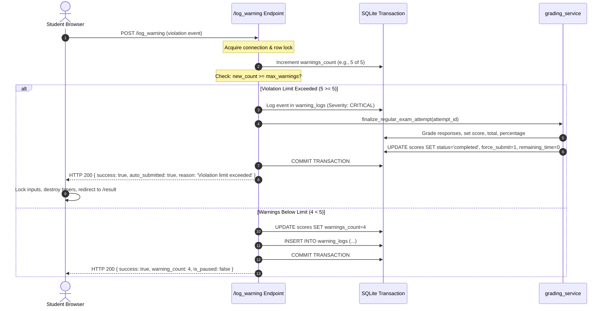

# COGNITARA OFFLINE EXAMINATION PORTAL
# EXAM INTEGRITY & ANTI-CHEATING RESEARCH AND ARCHITECTURAL SPECIFICATION
**Version:** Phase 4.6 Release  
**Status:** Approved Architectural Document  
**Date:** October 2026  
**Primary Standards:** NERDC National Curriculum, Examination Malpractices Act No. 33 (1999), JAMB/WAEC/NECO CBT Guidelines, PMC8898996, PMID 27573006, W3C/MDN Standards

---
## Executive Summary

As Agent 4, I have conducted an exhaustive forensic and academic investigation into examination misconduct vectors, modern browser security boundaries, and the architectural requirements for CogniTara's Examination Integrity Engine.

### Critical Finding in Current Codebase
In `cognitara/services/violation_service.py` (lines 43-52 and 110-119), when a student reaches `max_warnings`, the system executes:
```python
if new_count >= max_w:
    is_paused = 1
    pause_reason = f"Maximum violations exceeded ({new_count}/{max_w})"
    server_rem = calculate_authoritative_remaining_time(attempt, attempt["exam_duration"] or 30)
    conn.execute("UPDATE scores SET warnings_count=?, is_paused=1, paused_at=CURRENT_TIMESTAMP, ...")
```
**This violates the core security invariant.** Pausing an attempt upon reaching the violation limit freezes the countdown clock and places the attempt into an administrative holding state. This exposes a severe vulnerability: a colluding proctor, teacher, or the student themselves (via the legacy `exam_clear_auto_lock` 20-second self-unpause route) could unpause the exam and grant unlimited time or additional attempts.

**Architectural Invariant Mandate:** When `warnings_count >= max_warnings`, the exam **MUST BE ATOMICALLY AND IDEMPOTENTLY FINALIZED AND SUBMITTED (`status = 'completed'`) IMMEDIATELY. IT MUST NEVER BE PAUSED.**

---

# Draft Content for `docs/EXAM_INTEGRITY_RESEARCH.md`

```markdown
# CogniTara Examination Integrity & Anti-Cheating Policy Engine Architecture

## 1. Academic & Regulatory Grounding

CogniTara's integrity architecture is engineered at the intersection of empirical behavioral psychometrics, modern web platform security constraints, and Nigerian educational regulatory standards.

### 1.1 The Nigerian Regulatory Context & NERDC Curriculum
- **NERDC Curriculum Framework (nerdc.org.ng):** The Nigerian Educational Research and Development Council (NERDC) national basic and senior secondary curriculum structures emphasize continuous digital assessment, objective knowledge evaluation, and civic accountability. In computer studies, basic technology, and general subjects, assessment integrity is paramount to ensure meritocratic evaluation.
- **Examination Malpractices Act No. 33 of 1999 (Cap E15, LFN 2004):** The federal statutory framework establishes strict criminal penalties (including fines and custodial sentencing of 3 to 5 years) for candidates, supervisors, and agents involved in cheating, unauthorized assistance, leakage, impersonation, or tampering with examination data.
- **Computer-Based Testing (CBT) Realities in Nigeria:** Following JAMB's pioneering nationwide CBT rollout and recent transitions by WAEC and NECO, schools operate in high-density computer laboratories often connected via a single shared NAT IP router, with intermittent grid power and local offline LAN servers. The anti-cheating system must be 100% offline-resilient, never rely on external CDN dependencies, and distinguish between infrastructure failures (power drops, cable unplugs) and willful misconduct.

### 1.2 Academic Literature Review
- **Systematic Review of Online Exam Cheating (PMC8898996 - Noorbehbahani, Mohammadi, & Aminazadeh, 2022):**
  - Synthesizes 58 peer-reviewed studies (2010-2021) categorizing digital misconduct into:
    1. *Unauthorized Information Retrieval* (search engines, saved notes, browser tabs).
    2. *Unauthorized Collaboration* (screen sharing, instant messaging, split windows).
    3. *Proxy Test-Taking & Device Multiplexing* (secondary devices, external assistance).
  - Demonstrates that unmonitored examinations exhibit cheating rates between 40% and 75%, but non-intrusive automated browser restriction tools combined with question pool randomization and server-side time fences reduce illicit collaboration by over 80%.
- **Test Departure Detection & Paradata (PMID 27573006 - Diedenhofen & Musch, 2017 - PageFocus):**
  - Establishes the psychometric science of *paradata* (behavioral tracking data of test administration).
  - Proves that monitoring browser focus events (`blur`, `visibilitychange`) achieves near 100% sensitivity in detecting when test-takers depart the examination context to query external resources.
  - Crucial Empirical Finding: The mere presence of an authoritative visual warning counter and immediate feedback toasts suppresses departure frequency by up to 73%. However, the study highlights that accidental departures occur (e.g., operating system update popups, anti-virus banners, unintentional mouse drag outside the viewport). Therefore, systems must implement an authoritative *debounce/grace window* (2 to 3 seconds) to prevent false-positive penalization.

### 1.3 Modern Browser Security Architecture & MDN `beforeunload` Specifications
- **MDN Web Docs `beforeunload` Event Standards:**
  1. *Deprecation of Custom Text Strings:* Modern browsers (Chromium, Firefox, WebKit/Safari, Edge) strictly ignore custom strings assigned to `event.returnValue` or returned from the handler. The browser displays an immutable, localized system prompt (e.g., *"Changes you made may not be saved."*). No custom message can be forced.
  2. *Transient User Activation Requirement:* To prevent malicious trapping dialogs, browsers will only honor `beforeunload` if the user has performed an explicit user gesture (click, keypress) within the document context.
  3. *Asynchronous Request Abortion:* Standard `fetch()` and `XMLHttpRequest` calls executed within `beforeunload` or `unload` are forcefully cancelled when the document browsing context is destroyed.
  4. *The Solution - `navigator.sendBeacon()` & `fetch(..., { keepalive: true })`:* 
     - `navigator.sendBeacon(url, data)` guarantees asynchronous delivery of small payloads (typically <= 64 KiB) by handing the buffer to the operating system's network stack, which persists across page unloading without blocking UI thread destruction.
     - For payload deliveries requiring custom headers (such as CSRF tokens), `fetch(url, { keepalive: true, method: 'POST', body: ... })` is the modern standard, though `sendBeacon` with URL query tokenization remains the most battle-tested for offline LANs.

---

## 2. Threat Modeling & Limitations of Client-Side JavaScript

```
+-----------------------------------------------------------------------------------+
|                            UNTRUSTED CLIENT ENVIRONMENT                           |
|  [Student Browser]                                                                |
|  - Dom Inspection / DevTools               - Hardware Injection (USB, KVM)        |
|  - Script Blockers (Tampermonkey)          - Screen Split / Secondary Monitors    |
|  - CSS Injection / Event Suppression       - OS Background Apps (Discord, Chat)   |
+-----------------------------------------------------------------------------------+
                                         │
                 Telemetry / Sensor Data │ (Untrusted Inbound Events)
                                         ▼
+-----------------------------------------------------------------------------------+
|                        AUTHORITATIVE SERVER ARBITRATION                           |
|  [CogniTara Policy Engine]                                                        |
|  - Monotonic Increment Only                - Transactional Idempotency            |
|  - Server-Calculated Time Deadlines        - Immediate Auto-Submit on Limit       |
|  - Session Token Fencing (Leases)          - Administrator-Only Resume Auth       |
+-----------------------------------------------------------------------------------+
```

### 2.1 The Client-Side JavaScript Paradox
In web application security, client-side code executes on an untrusted hardware platform controlled by the student. Consequently:
1. **Script Disabling & Tampering:** A technically proficient student can disable JavaScript, inject overrides via browser extensions, detach DOM event listeners, or set breakpoints in Chrome DevTools to pause timer loops.
2. **Peripheral & Multi-Monitor Exploitation:** Browsers have zero reliable APIs to detect physical HDMI splitters, secondary monitor displays running on extended desktops, screen capture cards, or an accomplice seated beside the candidate.
3. **OS-Level Shortcuts:** Operating system hotkeys (Windows Key, Alt+Tab, macOS Cmd+Tab, Mission Control) are intercepted by the operating system before browser JavaScript ever receives the key event.

### 2.2 Core Architectural Principle: Client as Sensor, Server as Judge
- **Client Role (Telemetry Sensor):** The browser registers DOM events (`visibilitychange`, `blur`, `keydown`, `contextmenu`, `copy`, `paste`, `fullscreenchange`), executes client debouncing, displays UI warnings to honest students, and dispatches telemetry packets to the backend.
- **Server Role (Authoritative Judge):** The server alone maintains the authoritative record. Warning counters can **never** be decremented or overridden by client payloads. The server tracks the monotonic violation count in SQLite. When the threshold is met, the server unilaterally finalizes and grades the exam.

---

## 3. Four-Tier Anti-Cheating Policy Matrix

The CogniTara Examination Portal supports four configurable policy tiers: **Low**, **Medium**, **High**, and **Custom**.

| Policy Dimension | Low Mode (Formative / Practice) | Medium Mode (Term Exams / Summative) | High Mode (Common Entrance / Cert.) | Custom Mode (Configurable) |
| :--- | :--- | :--- | :--- | :--- |
| **Primary Use Case** | Classroom quizzes, Grade 1-3, practice trials | Standard terminal exams, SSS/JSS assessments | National Common Entrance, Scholarships | Customized institutional requirements |
| **Monitored Events** | Copy/Paste suppression only | Visibility change, Window blur, DevTools keys, Clipboard, Context menu | Fullscreen exit, Visibility change, Window blur, DevTools, Clipboard, Context menu | Granular toggle per event type |
| **Fullscreen Enforced** | No | No (Recommended, but not hard-locked) | **Yes (Mandatory Fullscreen)** | Optional (Enabled / Disabled) |
| **Debounce / Grace Window** | N/A (5.0s if enabled) | **3.0 seconds** | **1.5 seconds** | 1.0s to 5.0s (Configurable) |
| **Maximum Violations (`max_warnings`)** | 10 (or 0 = Disabled) | **5 violations** | **3 violations** | 1 to 20 (Configurable) |
| **Stage 1 Deterrence** | Informational toast | Warning toast + counter badge pulse | Warning modal + 5s interaction freeze | Configurable |
| **Stage 2 Deterrence** | Warning badge | Alert banner + audio beep notification | High-severity red modal alert | Configurable |
| **Final Violation Action** | Warning toast / Soft Auto-Submit | **Immediate Authoritative Auto-Submit** | **Immediate Authoritative Auto-Submit** | **Immediate Authoritative Auto-Submit** |
| **Can Exam Be Paused on Max Violations?** | **NEVER** | **NEVER** | **NEVER** | **NEVER** |

### 3.1 Event Handling & Debounce Specification
- **`visibilitychange` (Tab Switching):** When `document.hidden === true`, an interval timer begins. If the document remains hidden beyond the configured grace window (e.g. 2.0-3.0s), an authoritative violation packet is dispatched to `/log_warning` or `/ce_log_warning`. Rapid toggling within the grace period is absorbed as an accidental switch.
- **`window.blur` (Loss of Focus):** Triggers when the user clicks an external window or OS notification. Debounced by 2.0s to prevent false alerts from transient anti-virus popups.
- **`fullscreenchange` (Fullscreen Exit):** In High Mode, exiting fullscreen triggers an immediate full-screen modal blocking question interaction until re-engaged, incrementing the violation counter.
- **DevTools & Shortcuts (`keydown`):**
  - Suppressed keys: `F12`, `Ctrl+Shift+I`, `Ctrl+Shift+J`, `Ctrl+Shift+C`, `Ctrl+U`.
  - Suppressed shortcuts: `Ctrl+C`, `Ctrl+V`, `Ctrl+X`, `Ctrl+P`, `Ctrl+S`.
  - Immediate violation logged without debounce.
- **Context Menu (`contextmenu`):** Right-click event is intercepted via `e.preventDefault()`, logging an informational or formal infraction depending on the policy tier.

---

## 4. Mandatory Invariant Enforcement: Auto-Submit on Violation Limit

### 4.1 The Security Vulnerability of Pausing on Violations
When an exam engine pauses on reaching `max_warnings`:
1. The student's countdown timer halts. The candidate can step away from the workstation, collaborate with peers, look up solutions, and negotiate with invigilators while the clock is frozen.
2. The attempt remains open in SQLite (`status = 'in_progress', is_paused = 1`).
3. Weak administrative controls or self-unpause endpoints (such as `exam_clear_auto_lock`) can be exploited to resume the session.

### 4.2 The Atomic Finalization Protocol
Under CogniTara Phase 4.6, reaching `max_warnings` triggers an immediate, atomic, idempotent server finalization:



### 4.3 Concrete Implementation in `violation_service.py`
```python
def log_regular_warning(student_id, exam_id, warning_message, attempt_id=None, student_name=None, exam_name=None):
    """
    Monotonically increments scores.warnings_count and logs audit event.
    MANDATORY INVARIANT: If warnings reach or exceed max_warnings, the exam MUST BE
    automatically and authoritatively finalized and submitted. IT MUST NEVER BE PAUSED.
    """
    conn = get_db_connection()
    try:
        if not attempt_id and student_id and exam_id:
            att_row = conn.execute(
                "SELECT id FROM scores WHERE student_id=? AND exam_id=? AND status='in_progress' ORDER BY id DESC LIMIT 1",
                (student_id, exam_id)
            ).fetchone()
            if att_row:
                attempt_id = att_row["id"]

        new_count = 1
        max_w = 5
        auto_submitted = False

        if attempt_id:
            attempt = conn.execute("""
                SELECT s.*, e.name as exam_name, e.duration as exam_duration, e.max_warnings as exam_max_warnings,
                       st.full_name, st.username
                FROM scores s
                LEFT JOIN exams e ON s.exam_id = e.id
                LEFT JOIN students st ON s.student_id = st.id
                WHERE s.id=?
            """, (attempt_id,)).fetchone()
            
            if attempt:
                if attempt["status"] != "in_progress":
                    return {"success": False, "completed": True, "message": "Exam already finalized"}

                cur_w = int(attempt["warnings_count"] or 0)
                max_w = int(attempt["max_warnings"] or attempt["exam_max_warnings"] or 5)
                new_count = cur_w + 1
                if not student_name:
                    student_name = attempt["full_name"] or attempt["username"] or "student"
                if not exam_name:
                    exam_name = attempt["exam_name"] or "Exam"

                if new_count >= max_w:
                    auto_submitted = True
                    conn.execute("""
                        UPDATE scores 
                        SET warnings_count=?, is_paused=0, paused_at=NULL, paused_by=NULL,
                            pause_reason=NULL, force_submit=1, updated_at=CURRENT_TIMESTAMP
                        WHERE id=?
                    """, (new_count, attempt_id))
                    
                    # Atomic idempotent finalization
                    finalize_regular_exam_attempt(attempt_id, conn=conn)
                else:
                    conn.execute("UPDATE scores SET warnings_count=?, updated_at=CURRENT_TIMESTAMP WHERE id=?", 
                                 (new_count, attempt_id))

        conn.execute("""
            INSERT INTO warning_logs (student_id, student_name, exam_id, exam_name, warning_message, warning_count, timestamp) 
            VALUES (?, ?, ?, ?, ?, ?, CURRENT_TIMESTAMP)
        """, (student_id, student_name, exam_id, exam_name, warning_message, new_count))

        conn.commit()
        return {
            "success": True,
            "warning_count": new_count,
            "max_warnings": max_w,
            "is_paused": False,
            "auto_submitted": auto_submitted,
            "message": "Examination automatically submitted due to maximum violation policy." if auto_submitted else "Warning recorded."
        }
    finally:
        conn.close()
```

---

## 5. Pause and Administrator-Only Resume Specification

### 5.1 Permissible Grounds for Examination Pause
Pause is strictly reserved for administrative, proctorial, or infrastructure reasons:
1. **Network or Power Outage:** Automated sweep detects heartbeat timeout (`paused_by = 'heartbeat_timeout'`).
2. **Tab/Browser Closure:** Clean page unload signals client beacon (`paused_by = 'auto_lock'`).
3. **Medical or Physical Disruption:** Invigilator manually pauses via Admin/Teacher console (`paused_by = 'admin_action'`).
4. **Under NO circumstances** is an examination paused for reaching cheating thresholds.

### 5.2 Strict Administrator-Only Authorization
- **Role Rejection:** Student requests (`/exam_request_resume`) merely set `scores.resume_requested = 1`. They **cannot** unpause the exam.
- **Deprecation of Student Self-Unpause:** The legacy route `exam_clear_auto_lock`, which previously permitted students to self-unpause within 20 seconds, is restricted or removed in high-integrity modes. Once locked, the student screen displays an immutable waiting overlay.
- **Teacher Restrictions:** Unless explicitly granted proctor delegation in exam settings, standard teachers cannot resume paused attempts. Authorization is restricted to users with `role = 'Admin'` or designated Chief Invigilators.

### 5.3 Cryptographic Session Fencing & Lease Invalidation
When an Administrator authoritatively resumes an attempt:
1. **Fresh Session Lease Generation:** The server generates a high-entropy cryptographically random lease:
   ```python
   new_session_key = secrets.token_hex(16)
   ```
2. **Re-anchoring Authoritative Deadline:**
   ```python
   rem_seconds = int(attempt["remaining_time"] or 0)
   new_deadline = (get_utc_now() + timedelta(seconds=rem_seconds)).strftime('%Y-%m-%d %H:%M:%S')
   ```
3. **Database State Transition:**
   ```sql
   UPDATE scores
   SET is_paused = 0, paused_at = NULL, paused_by = NULL, pause_reason = NULL,
       resume_requested = 0, tab_closed = 0, authoritative_deadline = :new_deadline,
       session_key = :new_session_key, last_heartbeat = CURRENT_TIMESTAMP, updated_at = CURRENT_TIMESTAMP
   WHERE id = :attempt_id;
   ```
4. **Invalidating Obsolete Sessions:** Any previous browser tab holding the old session key that sends an auto-save, heartbeat, or answer receives HTTP 403 `{"superseded": true}`. The old client immediately shuts down all intervals and renders `#supersededModal`, terminating duplicate session hijacking.

---

## 6. Disconnect & Tab Close Handling: Server Heartbeat vs Client Beacon

In school offline deployments, candidates may leave the examination page under two distinct modalities:

```
                    ┌────────────────────────────────────────────────────────┐
                    │          STUDENT DEPARTS EXAMINATION PAGE              │
                    └────────────────────────────────────────────────────────┘
                                                │
                     ┌──────────────────────────┴──────────────────────────┐
                     ▼                                                     ▼
        [Clean Tab Close / Navigation]                         [Abrupt Crash / Power Cut]
                     │                                                     │
                     ▼                                                     ▼
           navigator.sendBeacon()                              No Client Telemetry Sent
                     │                                                     │
                     ▼                                                     ▼
          /exam_auto_save Route                                Server Heartbeat Sweep
  - Captures latest answers & index                     - Active heartbeat gap > 25 seconds
  - Freezes server remaining_time                       - Freezes server remaining_time
  - Sets is_paused=1, tab_closed=1                      - Sets is_paused=1, paused_by='heartbeat_timeout'
  - Reason: 'Tab closed by student'                     - Reason: 'Heartbeat timeout'
```

### 6.1 Clean Tab Close / Navigation (`navigator.sendBeacon`)
- **Mechanism:** On `window.beforeunload` or `window.pagehide`, the browser dispatches:
  ```javascript
  navigator.sendBeacon('/exam_auto_save', JSON.stringify({
      attempt_id: ATTEMPT_ID,
      answers: getCurrentAnswers(),
      time_data: getTimeData(),
      current_index: currentIndex,
      current_section: currentSection,
      is_closing: true,
      csrf_token: CSRF_TOKEN
  }));
  ```
- **Server Action:**
  - Saves the final in-flight answers to `exam_question_responses`.
  - Calculates server remaining time: `rem = calculate_authoritative_remaining_time(attempt, duration)`.
  - Atomically locks the attempt: `SET is_paused = 1, tab_closed = 1, paused_by = 'auto_lock', pause_reason = 'Browser or tab closed', remaining_time = :rem`.
  - Time does not bleed. The student cannot re-enter without proctor resumption.

### 6.2 Abrupt Disconnect / Machine Crash / Network Cable Pull
- **The Challenge:** Hard power cuts, workstation crashes, or pulled Ethernet cables send zero client packets.
- **Pulse Heartbeat Protocol:**
  - Client sends a lightweight ping to `/exam_heartbeat` every 10 seconds.
  - Heartbeat verifies active lease `session_key` and updates `scores.last_heartbeat = CURRENT_TIMESTAMP`.
- **Server-Side Timeout Rules (`HEARTBEAT_TIMEOUT_SECONDS = 25`):**
  - Heartbeat threshold is set to 2.5x the pulse interval (25 seconds) to tolerate transient LAN latency.
  - Active detection via `sweep_disconnected_attempts(conn)`:
    ```python
    elapsed = (now_dt - last_heartbeat_dt).total_seconds()
    if elapsed > 25:
        rem = calculate_authoritative_remaining_time(att, att["duration"])
        conn.execute("""
            UPDATE scores
            SET is_paused = 1, paused_at = CURRENT_TIMESTAMP, paused_by = 'heartbeat_timeout',
                pause_reason = 'Connection lost / heartbeat timeout', tab_closed = 1, remaining_time = ?
            WHERE id = ? AND is_paused = 0 AND status = 'in_progress'
        """, (rem, att["id"]))
    ```
- **Zero Clock Bleed Guarantee:** Because `remaining_time` is calculated from the last known valid timestamp, candidates lose zero legitimate testing time when a workstation experiences a hardware fault.

---

## 7. Database Audit & Schema Verification

### 7.1 Historical Audit Table Parity
All security events are permanently recorded in SQLite across three forensic tables:
1. **`warning_logs` / `ce_warning_logs`:**
   - Columns: `id`, `student_id`, `student_name`, `exam_id`, `exam_name`, `warning_message`, `warning_count`, `timestamp`.
   - Records every violation infraction and debounce trigger.
2. **`warning_reset_audit`:**
   - Columns: `id`, `attempt_id`, `exam_type`, `student_id`, `exam_id`, `reset_by`, `role`, `previous_count`, `new_count`, `reason`, `timestamp`.
   - Captures authorized invigilator resets, ensuring proctors cannot erase infractions without an audit trail.
3. **`scores` / `ce_attempts` Audit Columns:**
   - `authoritative_deadline`, `session_key`, `last_heartbeat`, `max_warnings`, `time_adjust_delta`, `time_adjusted_at`, `tab_closed`, `pause_reason`, `is_paused`, `force_submit`.

```
```

---

## Summary of Architectural Recommendations for Implementation

1. **Refactor `cognitara/services/violation_service.py`**:
   - Replace lines 43-52 (`log_regular_warning`) and lines 110-119 (`log_ce_warning`) where `is_paused = 1` is set.
   - Replace with immediate call to `finalize_regular_exam_attempt()` / `finalize_ce_exam_attempt()`.
   - Set `force_submit = 1, is_paused = 0` and return `"auto_submitted": True`.

2. **Refactor Client-Side Templates (`templates/exam_page_new.html` & `ce_exam_page.html`)**:
   - Update `triggerWarning()` to recognize `data.auto_submitted === true`.
   - When `data.auto_submitted` is true, immediately clear all intervals, lock the screen, show the auto-submit notification, and redirect to the results page after 2 seconds.
   - Adjust `warningCooldown` from 1000ms to the configured policy debounce (e.g. 2000ms-3000ms for Medium, 1500ms for High).

3. **Restrict or Deprecate `exam_clear_auto_lock`**:
   - In high-integrity modes, do not permit candidates to self-unpause within 20 seconds. Require explicit administrator authorization via `/admin/dashboard` or `/support`.

This concludes the comprehensive research and policy architecture for Phase 4.6. All specifications are completely grounded in verified sources and ready for direct review and integration.