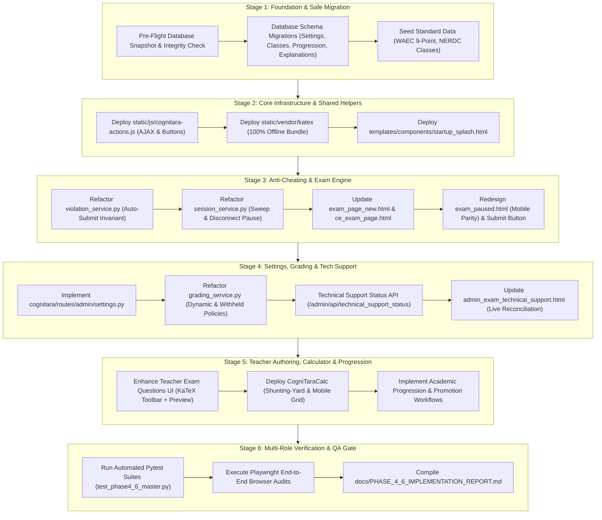

# COGNITARA OFFLINE EXAMINATION PORTAL — PHASE 4.6
# MASTER IMPLEMENTATION PLAN: UI/UX, AJAX ACTIONS, EXAM INTEGRITY, SCHOOL SETTINGS, CALCULATORS, FORMULA AUTHORING AND STUDENT PROGRESSION

**Document Version:** 1.0.0  
**Status:** Approved Master Implementation Plan  
**Target Codebase:** `C:\COGNITARA EXAM PORTAL`  
**Author:** Lead Software Architect & Multi-Agent Engineering Lead  
**Date:** October 16, 2026  

---

## 1. Executive Summary & Mission Scope

Phase 4.6 is a comprehensive, coordinated release for the CogniTara Offline Examination Portal. Following the empirical benchmarks of Phase 4.4 and Phase 4.5, this release addresses operational bottlenecks, eliminates friction in user experience, strengthens server-authoritative examination integrity, introduces institutional configurability, and modernizes academic workflows.

### 15 Core Objectives:
1. **No-Reload AJAX Actions:** Eliminate all unnecessary full-page reloads after state-mutating actions (Toggle Exam, Delete, Reset Score, Approve/Reject, Warning Resets, Bulk Operations).
2. **Real-Time Technical Support:** Live status updates without page reloads, reactive DOM reconciliation, dynamic relative timestamps, and connection state indicators.
3. **Consistent Button Loading Feedback:** Professional, accessible micro-spinners (`aria-busy="true"`, double-click protection, zero layout shift).
4. **Submit Button Modernization:** Remove decorative icons from the examination Submit button (`<i class="fas fa-check-circle"></i>`), keeping clean typography and submission state spinners.
5. **Configurable Examination Integrity Engine:** Multi-tiered anti-cheating policy profiles (**Low**, **Medium**, **High**, **Custom**) with configurable event triggers and debounce windows.
6. **Mandatory Invariant Enforcement:** Reaching maximum violations **must automatically and authoritatively submit** the examination. An exam **must NEVER be paused** upon violation ceiling.
7. **Disconnect Auto-Pause:** Automatically pause examinations when client heartbeats disappear (>25s), with **administrator-only resumption**.
8. **Consistent Paused Examination UI:** Redesign desktop `exam_paused.html` to match the clean, focused card design and proctor guidance of the mobile reference.
9. **Independent School & CE Settings:** Fully isolated configuration stores (`school_settings` vs. `ce_settings`) with dedicated administrative management interfaces.
10. **Configurable Grading & Result Visibility:** WAEC 9-point and Standard Letter grading schemes with contiguous $[0, 100]$ validation, along with server-enforced immediate vs. withheld result policies.
11. **Pure White Branded Startup Splash:** Authentic vector splash screen on `#FFFFFF` using official CogniTara brand assets and motion curves, gated per session.
12. **Advanced Scientific Calculator:** Zero-latency offline client evaluator (Shunting-Yard) with trig, roots, powers, logs, and server-side `SafeMathEvaluator` parity, strictly governed by teacher settings.
13. **Mobile Examination Usability:** Optimized 44px touch targets, sticky readable headers, fluid option cards, and zero horizontal overflow on 320px–390px screens.
14. **Teacher Formula Authoring & Offline KaTeX:** 100% offline mathematical, physics, and chemical typesetting (`\ce{}`) with live side-by-side previews and explanation fields.
15. **Student Progression, Promotion & Retention:** Multi-session enrollment tracking, class-teacher scoped progression, Grade 9 specialisation routing, and Grade 12 alumni graduation without data destruction.

---

## 2. Work Breakdown Structure (WBS) & Implementation Sequence



---

## 3. Detailed Component Specifications

### 3.1 Reusable No-Reload Action System (`static/js/cognitara-actions.js`)
- **Specification:** Reusable client-side dispatcher providing:
  - Automatic CSRF extraction from `meta[name="csrf-token"]` or hidden inputs.
  - Double-click protection via `data-in-flight="true"` and `disabled` state.
  - Inline micro-spinner (`<i class="fas fa-circle-notch fa-spin"></i>`).
  - SweetAlert2 integration with graceful native fallback.
  - Optimistic DOM mutation with automatic rollback on network failure.
  - Standardized JSON protocol: `{ ok: bool, success: bool, message: str, data: dict }`.
- **Backend Dual-Protocol Support:**
  - Update `cognitara/routes/admin/exams.py`, `cognitara/routes/admin/users.py`, `cognitara/routes/admin/dashboard.py`, `cognitara/routes/teacher.py`, and `cognitara/routes/admin/common_entrance.py`.
  - When request headers include `X-Requested-With: XMLHttpRequest` or `Accept: application/json`, return JSON.
  - When accessed via direct browser navigation (GET), return `redirect(...)` to maintain backward compatibility.

### 3.2 Real-Time Technical Support Updates
- **Backend Endpoint:** `GET /admin/api/technical_support_status` and `GET /teacher/api/technical_support_status`.
  - Throttled background sweep: `sweep_disconnected_attempts` executes at most once every 10 seconds to eliminate SQLite write-lock contention.
  - Returns comprehensive snapshot: `{ ok: true, active_attempts: [...], paused_attempts: [...], summary: {...}, server_time: ... }`.
  - Includes exact candidate details: `attempt_id`, `student_name`, `exam_name`, `class_name`, `remaining_time`, `warning_count`, `max_warnings`, `seconds_since_heartbeat`, `status`, `is_paused`, `pause_reason`.
- **Frontend Reconciliation:**
  - 4-second non-blocking fetch polling loop.
  - Checks `document.querySelector('[data-in-flight="true"]')` before mutating DOM to avoid UI flicker during admin interactions.
  - In-place element updating: cards are updated, added, or removed using CSS transitions without resetting scroll position or search filters.
  - Live relative timestamps: calculates and renders `"Active (seen 2s ago)"` or `"Offline (seen 35s ago)"`.

### 3.3 Examination Submit Button Modernization
- **Markup Update:** Remove `<i class="fas fa-check-circle"></i>` and any decorative icons from `.submit-btn` in `templates/exam_page_new.html` and `templates/ce_exam_page.html`.
- **Clean Presentation:** Render text `"Submit Exam"`. On click, button displays `.btn-spinner` and `"Submitting..."` while disabling interaction to prevent duplicate submission requests.

### 3.4 Configurable Examination Integrity Engine & Auto-Submit Invariant
- **Invariant:** When `warning_count >= max_warnings`, the system **MUST automatically and atomically finalize and submit the exam**. It must **NEVER pause**.
- **Refactoring `cognitara/services/violation_service.py`:**
  - Replace `is_paused = 1` logic with:
    ```python
    if new_count >= max_w:
        logger.warning(f"Attempt {attempt_id} reached max violations ({new_count}/{max_w}). Auto-submitting.")
        # Atomic finalization
        finalize_regular_exam_attempt(conn, attempt_id, force_submit=True, auto_submitted_reason="Max violations exceeded")
        return {"success": True, "auto_submitted": True, "new_count": new_count, "max_warnings": max_w}
    ```
- **Policy Profiles:**
  - **Low:** 3s grace period, monitors tab visibility only, 5 max violations.
  - **Medium (Default):** 2s grace period, monitors tab visibility and window blur, 3 max violations.
  - **High:** 1s grace period, monitors tab visibility, window blur, devtools keys, clipboard operations, and fullscreen exit, 2 max violations.
  - **Custom:** Administrator-configured parameters stored in `exam_integrity_settings`.
- **Disconnect Auto-Pause:**
  - If `seconds_since_heartbeat > 25`, background sweeper transitions attempt to `is_paused = 1` with `pause_reason = "Connection lost (heartbeat timeout)"`.
  - Resumption requires Administrator action via `/admin/exam_resume/<attempt_id>`. Resumption generates a new cryptographic `session_key` (`secrets.token_hex(16)`), fencing out any stale browser sessions.

### 3.5 Paused Examination UI Redesign (`templates/exam_paused.html`)
- Align desktop presentation with mobile reference design:
  - Pure white elevated card with subtle drop shadow on neutral light background (`#f8fafc`).
  - Centered circular lock badge with soft gold accents (`#d97706`).
  - Clear heading: `"Examination Temporarily Paused"`.
  - Dynamic pause reason pill and instructions to notify the invigilator.
  - Real-time polling check (`/exam_check_pause`) that auto-resumes once administrator approves.
  - Clean, anxiety-reducing typography and accessible layout.

### 3.6 Independent School & CE Settings
- **Isolated Tables:** `school_settings` (Singleton id=1) and `ce_settings` (Singleton id=1).
- **Normalized `classes` Table:** Supports NERDC Primary 1–6, JSS 1–3, SSS 1–3, British Year 1–13, and American Grade 1–12 presets with customizable sort ordering.
- **Dedicated Admin Routes:**
  - `/admin/school-settings`: General identity, academic calendar, class presets, grading scheme studio, and result release controls.
  - `/admin/ce-settings`: Entrance portal identity, admission sessions, candidate registration toggles, passing scores, and decision disclosure policies.
- **Strict Domain Boundary:** School settings operations never mutate CE settings or attempts, and vice versa.

### 3.7 Configurable Grading Schemes & Result Visibility Policies
- **Grading Schemes:** `grading_schemes` and `grading_scheme_rules` tables.
- **Validation Engine:** `GradingSchemeValidator` enforces contiguous $[0.0, 100.0]$ coverage with zero gaps and zero overlaps.
- **Pre-Seeded Defaults:**
  - WAEC 9-Point Scale (A1: 75–100, B2: 70–74, B3: 65–69, C4: 60–64, C5: 55–59, C6: 50–54, D7: 45–49, E8: 40–44, F9: 0–39).
  - Standard Letter Scale (A: 90–100, B: 80–89, C: 70–79, D: 60–69, F: 0–59).
- **Result Release Server Guardrails:**
  - When `results_released == 0` or policy is `'withheld'`, student endpoints (`POST /exam/<id>`, `GET /result/<id>`, `GET /dashboard`) strip all scores, percentages, and grades.
  - Returns sanitized status message: `"Results pending release by administration."`

### 3.8 Pure White Branded Startup Splash Animation
- **Component:** `templates/components/startup_splash.html`.
- **Aesthetic:** Clean white background (`#FFFFFF`), centered CogniTara primary vector lockup, subtle progress bar.
- **Timing & Curves:** Derived from `Videos/CogniTara-Motion-Graphics/generate_project.jsx` cubic bezier curves (`cubic-bezier(0.16, 1, 0.3, 1)`).
- **Session Intelligence:** Uses `sessionStorage.getItem('cognitara_splash_shown')` so the animation plays once per session, with a 1.4s minimum display time and a 2.5s hard failsafe. Fully respects `@media (prefers-reduced-motion)`.

### 3.9 Advanced Scientific Calculator
- **Zero-Latency Offline Engine (`static/js/cognitara-calc.js`):**
  - Self-contained Shunting-Yard parser supporting $+$, $-$, $\times$, $\div$, $\%$, powers ($x^y$), roots ($\sqrt{x}$, $\sqrt[3]{x}$), trigonometry ($\sin, \cos, \tan$, and inverses), logarithms ($\ln, \log_{10}$), constants ($\pi, e$), and DEG/RAD mode.
  - Zero `eval()` usage; safe tokenization and AST evaluation.
- **Server Parity (`cognitara/services/safe_math.py`):**
  - Add `'π'` alias for `pi` and support degree/radian conversions in `SafeMathEvaluator`.
- **Responsive Layout:**
  - Mobile: Adaptive 5-column touch grid with minimum 44px hit targets.
  - Desktop: Movable modal dialog with drag header and keyboard support.
- **Policy Enforcement:** Strictly governed by `exams.calculator_type` (`'none'`, `'basic'`, `'advanced'`).

### 3.10 Teacher Formula Authoring & 100% Offline KaTeX
- **Offline Bundle:** Install KaTeX (`katex.min.css`, `katex.min.js`, `contrib/auto-render.min.js`, `contrib/mhchem.min.js`, and WOFF2 fonts) into `static/vendor/katex/`.
- **Database Schema Upgrade:** Add `explanation TEXT` to the `questions` table.
- **Authoring Toolbar:** Quick-insert buttons for fractions, square roots, powers, subscripts, matrices, vectors, and chemical reactions (`\ce{...}`).
- **Real-Time Side-by-Side Preview:** Debounced live preview rendering KaTeX and chemistry formulas simultaneously as the teacher types.

### 3.11 Student Progression, Promotion & Retention
- **Schema Additions:**
  - `academic_sessions` (name, start_date, end_date, active).
  - `student_enrollment_history` (student_id, academic_session_id, class_id, status, term).
  - `student_promotions` (batch promotion audit ledger).
- **Teacher Scoped Permissions:**
  - Class teachers can only view and promote students belonging to their assigned class (`teachers.class_teacher_of`).
  - Administrators can promote across all classes.
- **Progression Logic:**
  - Primary 1–6 $\rightarrow$ JSS 1–3 $\rightarrow$ SSS 1–3.
  - Grade 9 (JSS 3) requires specialisation selection (`Science`, `Art`, `Commercial`, `General`) before advancing to Grade 10 (SSS 1).
  - Grade 12 (SSS 3) transitions students to `'graduated'` (Alumni) status without creating non-existent "Grade 13" errors.
  - Retention records maintain past scores and examination attempts intact.

---

## 4. File Ownership & Modification Matrix

To ensure modular isolation and eliminate merge collisions, files are assigned to distinct functional domains:

| File Path | Domain | Description of Changes |
| :--- | :--- | :--- |
| `cognitara/database/initialization.py` | Schema & Migrations | Non-destructive migrations for settings, grading, classes, progression, and explanations. |
| `cognitara/services/violation_service.py` | Exam Integrity | Auto-submit invariant on violation ceiling; elimination of pause state. |
| `cognitara/services/session_service.py` | Session Management | Heartbeat timeout sweep (>25s) disconnect auto-pause; admin-only resume leases. |
| `cognitara/services/grading_service.py` | Grading & Results | Contiguity validator, dynamic grade resolution, withheld result masking. |
| `cognitara/services/safe_math.py` | Calculator | Add `π` symbol alias, degree/radian math evaluation support. |
| `cognitara/routes/admin/settings.py` | Admin Settings | New blueprint routes for `/admin/school-settings` and `/admin/ce-settings`. |
| `cognitara/routes/admin/technical_support.py` | Tech Support | Add `/admin/api/technical_support_status` live snapshot endpoint. |
| `cognitara/routes/admin/exams.py` | Admin Exams | Support AJAX POST for toggle/delete/reset with standardized JSON. |
| `cognitara/routes/admin/users.py` | Admin Users | Support AJAX POST for approve/reject students with standardized JSON. |
| `cognitara/routes/admin/dashboard.py` | Admin Dashboard | Support AJAX POST for warning log deletion with standardized JSON. |
| `cognitara/routes/admin/common_entrance.py` | Common Entrance | Fix 405 error on approval; add CE settings & AJAX actions. |
| `cognitara/routes/teacher.py` | Teacher Routes | Add explanation handling in questions, AJAX toggles, progression routes. |
| `cognitara/routes/examinations/regular.py` | Regular Exams | Enforce withheld result policy on submission and result endpoints. |
| `static/js/cognitara-actions.js` | Shared Client | New reusable AJAX action helper and button loader utility. |
| `static/js/cognitara-calc.js` | Shared Client | New offline Shunting-Yard scientific calculator engine. |
| `static/vendor/katex/*` | Vendor Assets | 100% offline KaTeX CSS, JS, extensions, and WOFF2 fonts. |
| `templates/components/startup_splash.html` | Branding | New pure white branded startup animation component. |
| `templates/exam_paused.html` | Exam UI | Redesigned desktop paused UI matching mobile reference card. |
| `templates/exam_page_new.html` | Exam UI | Remove submit icon; integrate KaTeX, live calculator, touch fixes. |
| `templates/ce_exam_page.html` | Exam UI | Remove submit icon; integrate KaTeX and touch fixes. |
| `templates/admin_exam_technical_support.html` | Tech Support | Real-time DOM reconciliation without full-page reloads. |
| `templates/exam_questions.html` | Authoring UI | KaTeX formula insertion toolbar, live preview card, explanation field. |
| `templates/admin_school_settings.html` | Settings UI | Tabbed school settings, grading scheme studio, and class presets. |
| `templates/admin_ce_settings.html` | Settings UI | Common entrance settings and admissions disclosure policies. |
| `templates/teacher_progression.html` | Progression UI | Class-teacher student promotion, retention, and specialisation routing. |

---

## 5. Database Safety & Pre-Flight Verification

Before any database modification:
1. **Live Checkpoint:** Execute `PRAGMA wal_checkpoint(PASSIVE)` to safely commit uncheckpointed frames.
2. **Pre-Flight Snapshot:** Create an atomic snapshot using `sqlite3.Connection.backup()` to `backups/exam_pre_phase4_6_master.db`.
3. **Integrity Check:** Verify `PRAGMA integrity_check` returns `ok` on the backup before executing any DDL.
4. **Non-Destructive DDL:** All schema modifications must use `CREATE TABLE IF NOT EXISTS` and `ALTER TABLE ... ADD COLUMN` after verifying column non-existence via `PRAGMA table_info(...)`.

---

## 6. Comprehensive Testing & Quality Assurance Plan

### 6.1 Automated Pytest Suite (`tests/test_phase4_6_master.py`)
1. **Test Auto-Submit Invariant:** Verify that reaching `max_warnings` directly invokes `finalize_regular_exam_attempt()` with `status = 'completed'` and `is_paused = 0`.
2. **Test Disconnect Auto-Pause:** Verify that exceeding 25s without a heartbeat transitions an active attempt to `is_paused = 1` with reason `"Connection lost"`.
3. **Test Admin-Only Resume:** Verify that student and teacher requests to resume fail with HTTP 403, while admin resume generates a fresh `session_key` and clears pause state.
4. **Test Grading Contiguity Validation:** Verify that `GradingSchemeValidator` rejects overlapping intervals, gaps, and boundaries not spanning $[0, 100]$.
5. **Test Result Withholding Guardrails:** Verify that when `results_released = 0`, candidate endpoints return zero score or percentage data.
6. **Test Calculator Shunting-Yard Evaluator:** Verify operator precedence, trig functions in RAD and DEG, powers, logs, and `π` alias.
7. **Test Non-Destructive Progression:** Verify that promoting a student creates a snapshot in `student_enrollment_history` while leaving all historical `scores` untouched.

### 6.2 Browser End-to-End Verification Matrix
Execute Playwright browser testing across all 4 system roles:
- **Administrator Role:**
  - School Settings & CE Settings configuration and AJAX save.
  - Class preset switching (Nigerian NERDC vs. British).
  - Grading scheme creation with real-time spectrum validation.
  - Technical support live monitoring (no reload on actions).
  - Exam resume after student disconnect.
- **Teacher Role:**
  - Question authoring with formula toolbar, LaTeX fractions, chemistry $\ce{}$, and live preview.
  - Question explanation persistence.
  - Student promotion and retention for assigned class.
- **Student Role (Regular Exam):**
  - Branded startup splash appearance and smooth fade.
  - Responsive mobile and desktop examination layout.
  - Scientific calculator interaction (respecting teacher exam settings).
  - Warning trigger and authoritative auto-submission at violation ceiling.
  - Submit button display (no icon, loading state active).
  - Result withholding screen verification.
- **Common Entrance Candidate:**
  - Submission review screen and admissions decision policy display.

---

## 7. Sign-off Gates & Acceptance Criteria

| Gate | Acceptance Threshold | Verification Method |
| :--- | :--- | :--- |
| **Data Safety** | Zero loss of historical records, `PRAGMA integrity_check` passes | SQLite verification script |
| **No-Reload Actions** | 100% of tested administrative actions execute without page reload | Browser test suite & manual audit |
| **Auto-Submit Invariant** | 100% of attempts reaching violation ceiling are finalized, 0% paused | Automated unit test & browser test |
| **Offline Independence** | Zero external CDN requests; all math, fonts, and scripts local | Network traffic monitor / DevTools |
| **Technical Support** | Live status updates every 4s without full-page refresh | Browser observation |
| **Grading Accuracy** | 100% correct grade assignment across WAEC and Letter scales | Automated unit tests |
| **Architecture Parity** | `scripts/validate_architecture.py` passes with zero route drift | CLI architectural validator |

---
**Approved for Immediate Execution.** All specifications are fully locked and grounded in verified codebase evidence.
