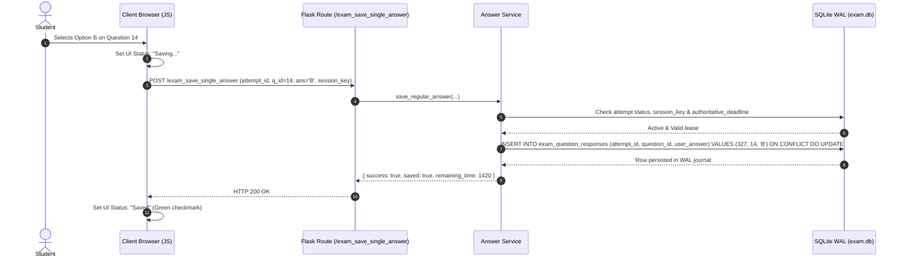
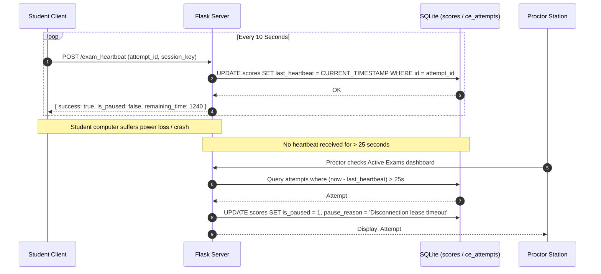
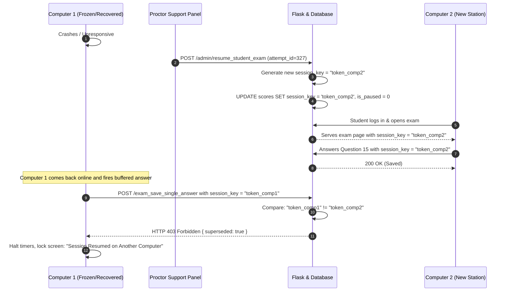
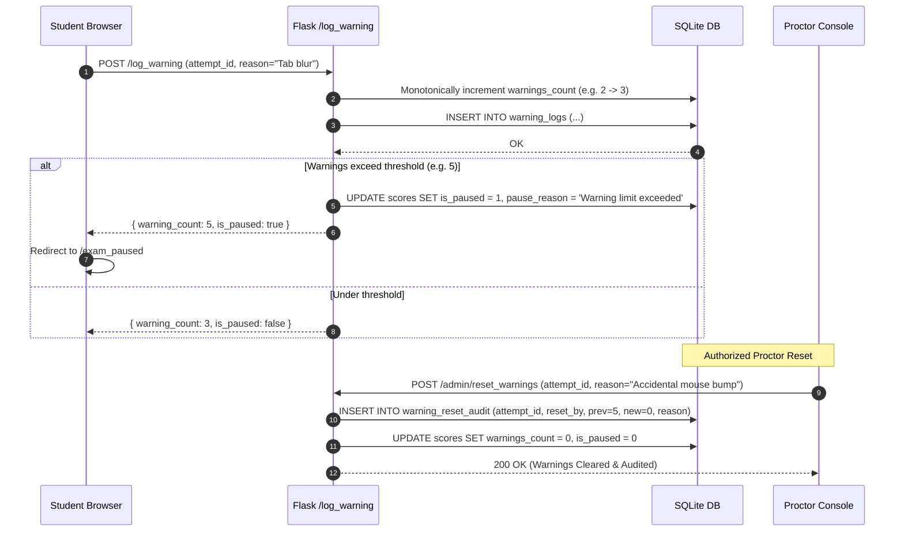

# CogniTara Examination Portal — Data Flow & Sequence Architecture

This document details the server-authoritative data flows, state transitions, and sequence diagrams for student examination lifecycles, answer persistence, session recovery, and violation handling.

---

## 1. Instant Single-Answer Persistence Flow

In CogniTara, answers are not buffered solely in browser memory or held until final submission. Every single option selection or input change initiates an immediate asynchronous persistence request to the server.

### Technical Mechanics:
1. **Trigger:** The student clicks an answer radio button or modifies an input in `exam_page_new.html` or `ce_exam_page.html`.
2. **UI Feedback:** The status indicator transitions immediately to `"Saving..."` with an active spinning icon.
3. **Transport:** An asynchronous `fetch` POST sends the student ID, attempt ID, question ID, answer payload, time spent, and `session_key` to `/exam_save_single_answer` (or `/ce_save_single_answer`).
4. **Server Validation:**
   - Validates CSRF token.
   - Verifies active session lease (`session_key == score.session_key`).
   - Verifies examination is not paused (`is_paused == 0`).
   - Verifies remaining time has not expired against `authoritative_deadline`.
5. **Persistence:** Executes atomic SQLite `INSERT ... ON CONFLICT(attempt_id, question_id) DO UPDATE SET user_answer=excluded.user_answer, time_spent=excluded.time_spent` and commits immediately to the Write-Ahead Log (WAL).
6. **Acknowledgment:** Returns HTTP 200 `{ "success": true, "saved": true }`.
7. **UI Confirmation:** The indicator transitions to `"Saved"` with a green checkmark.

### Sequence Diagram:

---

## 2. Heartbeat & Disconnect Auto-Pause Flow

To ensure examination security without unfairly penalizing students when hardware crashes or network drops occur, CogniTara implements a continuous server heartbeat loop.

### Technical Mechanics:
1. **Interval:** The client browser sends a periodic heartbeat every 10 seconds to `/exam_heartbeat` or `/ce_heartbeat`.
2. **Server Refresh:** Updates `last_heartbeat = CURRENT_TIMESTAMP` and recalculates remaining seconds until `authoritative_deadline`.
3. **Disconnection Detection:** If a computer shuts down, crashes, or loses network connection, the heartbeat stops.
4. **Auto-Pause Threshold:** When the server or proctor detects `strftime('%s', 'now') - strftime('%s', last_heartbeat) > 25`, the attempt is safely flagged as `is_paused = 1` with `pause_reason = 'Heartbeat timeout'`. The timer stops on the server, freezing the remaining duration.

### Sequence Diagram:

---

## 3. Cross-Computer Session Fencing & Recovery

If a student moves to a replacement computer in the exam hall, CogniTara fences old sessions to eliminate dual-submission conflicts and phantom writes.

### Technical Mechanics:
1. **Incident:** Computer 1 freezes or hardware fails.
2. **Proctor Action:** Proctor opens the technical support panel and authorizes an exam resumption on Computer 2.
3. **Lease Rotation:** The server generates a brand-new cryptographic lease token: `new_session_key = secrets.token_hex(16)`, updates `scores.session_key = new_session_key`, and clears `is_paused = 0`.
4. **Resume on Computer 2:** Student logs in on Computer 2 and loads the exam page, receiving the new active `session_key`.
5. **Old Device Fencing:** If Computer 1 suddenly recovers and attempts to send buffered answers or heartbeats using `old_session_key`, the server compares keys:
   `if attempt["session_key"] != request_session_key: return { "error": "superseded", "superseded": true }, 403`
6. **Client Interception:** Computer 1 receives HTTP 403, displays a modal: *"Session Resumed on Another Computer"*, and halts all local background polling and timers.

### Sequence Diagram:

---

## 4. Server-Authoritative Violation Monotonic Tracking & Audit Flow

Student violation counts (e.g. tab switches, fullscreen escapes, secondary window detection) are strictly server-authoritative and monotonic.

### Technical Mechanics:
1. **Violation Event:** Client detects a blur or visibility change event.
2. **Server Ingestion:** Client posts to `/log_warning`.
3. **Monotonic Increment:** The server reads current warnings from `scores.warnings_count`, increments by 1, and inserts an audit row into `warning_logs`.
4. **Enforcement:** If `new_warnings >= max_warnings`, the server sets `is_paused = 1` and returns `is_paused: true`. The client immediately redirects to `/exam_paused`.
5. **Proctor Reset with Audit:**
   - The student cannot reset their own warnings.
   - An authorized proctor or teacher submits `/admin/reset_warnings/<attempt_id>` with a required reason (e.g., *"Accidental touch of mouse cord"*).
   - The server resets `warnings_count = 0` and atomically writes to `warning_reset_audit` with `reset_by`, `role`, `previous_count`, `new_count`, `reason`, and `timestamp`.

### Sequence Diagram:

---

## 5. Summary of Endpoint Response Contracts

| Endpoint | Method | Key Request Parameters | Success Response (200) | Error Responses |
| :--- | :--- | :--- | :--- | :--- |
| `/exam_save_single_answer` | POST | `attempt_id`, `question_id`, `answer`, `session_key` | `{"success": true, "saved": true, "remaining_time": int}` | `400` (CSRF), `403` (`superseded`), `423` (`paused`), `410` (`time_up`) |
| `/ce_save_single_answer` | POST | `attempt_id`, `question_id`, `answer`, `session_key` | `{"success": true, "saved": true, "remaining_time": int}` | `400` (CSRF), `403` (`superseded`), `423` (`paused`), `410` (`time_up`) |
| `/exam_heartbeat` | POST | `attempt_id`, `session_key` | `{"success": true, "is_paused": bool, "remaining_time": int}` | `403` (`superseded`), `404` (not found) |
| `/ce_heartbeat` | POST | `attempt_id`, `session_key` | `{"success": true, "is_paused": bool, "remaining_time": int}` | `403` (`superseded`), `404` (not found) |
| `/log_warning` | POST | `exam_id`, `reason`, `attempt_id` | `{"warning_count": int, "is_paused": bool, "max_warnings": int}` | `400` (CSRF), `401` (unauthorized) |
| `/admin/reset_warnings/<id>` | POST | `reason`, `exam_type` | `{"success": true, "new_count": 0, "previous_count": int}` | `401` (unauthorized), `404` (not found) |
